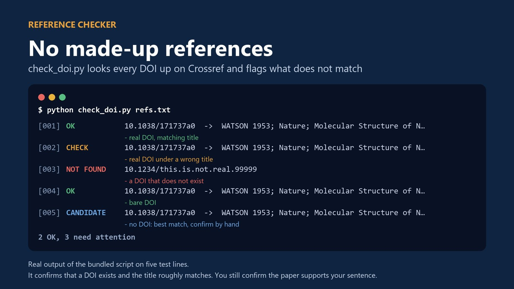
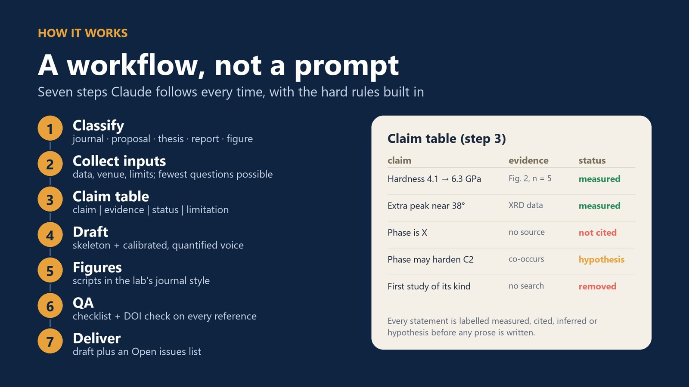

> **Quick answer:** AI drafts go wrong in predictable ways: references that do not exist, real DOIs attached to the wrong paper, "first study" claims nobody checked, and hypotheses written as results. Four habits prevent most of it: **build a claim table before any prose**, **look every DOI up on Crossref** (a short script below does it), **match the wording to the strength of the evidence**, and **never write "first" or "novel" without a documented search**. The free [Research Writing & Figure Skill](https://jerryhome6.gumroad.com/l/research-writing-skill) builds these rules into Claude.

Language models write fluent scientific prose, and that is the problem. A fluent paragraph with an invented reference reads exactly like a correct one, and the error usually surfaces at the worst moment: in a reviewer's report or after publication. The fix is not to avoid AI. It is to give it a workflow where evidence comes before words.

## What goes wrong when AI drafts a paper

- **Invented references.** Plausible authors, a plausible journal, a plausible DOI, but no such paper. Models predict text that looks like a citation; they do not look anything up unless a tool makes them.
- **Real DOI, wrong paper.** Harder to spot: the DOI resolves, but to a different article than the sentence claims.
- **Priority claims.** "This is the first study to…" appears because papers often say it, not because anyone searched.
- **Upgraded certainty.** "Suggests" becomes "demonstrates", a correlation becomes a mechanism, and a hypothesis from the Discussion turns up in the Abstract as a result.
- **Numbers without context.** "Significantly improved hardness" with no value, no unit, no n and no comparator.
- **Generic voice.** Text that could describe any material in any lab, which reviewers increasingly recognise.

None of these are fixed by a better prompt alone. They are fixed by deciding *what may be claimed* before asking for prose.

## Step 1: build a claim table before writing

List every statement the section will make, the evidence for it, and its status. Only then ask for a draft, and require the draft to stay inside the table.

| Claim | Evidence | Status | Limitation |
|---|---|---|---|
| Hardness rose from 4.1 to 6.3 GPa | Fig. 2, n = 5 | measured | one load only |
| Extra XRD peak near 38° | XRD data | measured | phase not identified |
| The new phase hardens the coating | co-occurs with hardness rise | hypothesis | not tested |
| First study of this system | no literature search | **removed** | — |

The four statuses are **measured** (your data), **cited** (a verified reference), **inferred** (reasoned from measured or cited facts) and **hypothesis** (plausible, untested). Each one maps to its own kind of wording (see Step 3). A prompt you can reuse:

```text
Here is my claim table (claim | evidence | status | limitation).
Draft the Results paragraph using only these claims.
- Do not add facts, numbers or references that are not in the table.
- Write measured claims with value, unit, n and comparator.
- Write inferred claims with "suggests" or "is consistent with".
- Write hypotheses as hypotheses ("may", "we propose").
- If something is needed but missing, write [TODO: ...] instead of guessing.
```


## Step 2: check every DOI against Crossref

Crossref's public API returns the metadata for any registered DOI and a 404 for one that does not exist. Checking the title as well catches a real DOI attached to the wrong paper. This script uses only the Python standard library:

```python
import json, urllib.request, urllib.error
from difflib import SequenceMatcher

def check(doi, claimed_title=''):
    url = 'https://api.crossref.org/works/' + doi
    req = urllib.request.Request(url, headers={'User-Agent': 'doi-check/1.0 (mailto:you@example.org)'})
    try:
        with urllib.request.urlopen(req, timeout=20) as r:
            msg = json.load(r)['message']
    except urllib.error.HTTPError as e:
        return 'NOT FOUND' if e.code == 404 else f'ERROR {e.code}', ''
    title = (msg.get('title') or [''])[0]
    if claimed_title and SequenceMatcher(None, claimed_title.lower(), title.lower()).ratio() < 0.6:
        return 'CHECK TITLE', title
    return 'OK', title

refs = [
    ('10.1038/171737a0', 'Molecular structure of nucleic acids'),
    ('10.1038/171737a0', 'Hardening of zirconia by yttria doping'),
    ('10.1234/this.is.not.real.99999', 'A paper the AI made up'),
]
for doi, title in refs:
    status, found = check(doi, title)
    print(f'{status:12} {doi:34} {found[:60]}')
```

Output:

```text
OK           10.1038/171737a0                   Molecular Structure of Nucleic Acids: A Structure for Deoxyr
CHECK TITLE  10.1038/171737a0                   Molecular Structure of Nucleic Acids: A Structure for Deoxyr
NOT FOUND    10.1234/this.is.not.real.99999
```

Put your own email in the User-Agent: Crossref asks API users to identify themselves. Two limits to keep in mind: a valid DOI only proves the paper **exists**, not that it **supports your sentence**, so open the paper and check. And references without a DOI (older books, some conference papers) still need a manual search.



## Step 3: match the wording to the evidence

| Status | Write it like this | Avoid |
|---|---|---|
| measured | "Hardness increased from 4.1 ± 0.2 to 6.3 ± 0.3 GPa (n = 5)." | "Hardness improved significantly." |
| cited | "…as reported for Y-doped ZrO₂ [12]." (DOI verified) | a reference you have not opened |
| inferred | "The shift suggests / is consistent with lattice expansion." | "proves", "demonstrates" |
| hypothesis | "The new phase may contribute to the hardening; we did not test this directly." | presenting it in the Abstract as a finding |

Two quick rules: every number gets a unit and a comparator (versus what?), and every "significantly" either has a statistical test behind it or is removed.

## Step 4: no "first" without a search

"The first study of X" is the claim reviewers are most likely to test. Either document the search (databases, keywords, date) or rewrite the claim as the specific increment you can defend:

- ❌ "This is the first study of yttria-doped coatings for wear applications."
- ✅ "Unlike earlier reports that measured hardness only, this work links hardness, phase content and wear rate in the same coatings."

The second version is more persuasive anyway, because it tells the reader exactly what is new.

## Journal policies on AI

Most major publishers now ask authors to **disclose** how generative AI was used and do **not** accept an AI tool as an author. The authors remain responsible for every claim and reference. Policies differ in the details (images, peer review, where the disclosure goes) and change often, so read your target journal's current guidelines before submitting. Never paste unpublished data or confidential reviewer material into a tool that your institution has not approved for it.

## The free skill that does this for you

The **[Research Writing & Figure Skill](https://jerryhome6.gumroad.com/l/research-writing-skill)** is a free skill for Claude that packages this workflow:

- **Workflows** for journal manuscripts, grant proposals, thesis chapters and progress reports, each starting from a claim table.
- **Hard rules:** no invented data or references, no "first / novel" claims without a documented search, hypotheses stay hypotheses, numbers carry units and a comparator. Missing facts become `[TODO]` items in an Open issues list.
- **check_doi.py**, an extended version of the script above that also suggests candidates for references without a DOI.
- **Publication-grade figure scripts** (Python / matplotlib): stacked XRD with reference cards and hkl labels, stacked FTIR/Raman, grouped bars with error bars.
- **Your own voice:** a script measures your papers (sentence length, citation density, connectives) so you can tune the style in about 15 minutes. It counts locally; your text stays on your computer.



**Install (Claude Code):** unzip, copy the `hulab-research-writing` folder to `~/.claude/skills/` (Windows: `C:\Users\<you>\.claude\skills\`), run `pip install numpy pandas matplotlib python-docx`, then ask Claude to "use the hulab-research-writing skill to draft the introduction of my paper on…". It also works in other Claude apps that accept skill folders.

The skill and the other research kits are in the [shop](/en/shop/).

## FAQ

### Why does AI make up references?

Language models generate text that looks like a citation from patterns in their training data. Unless a tool makes them look a reference up, nothing checks that the paper exists or says what the sentence claims.

### How can I check whether a reference is real?

Look the DOI up on Crossref: a registered DOI returns its metadata, a non-existent one returns 404. Compare the returned title with the one in your reference list, then open the paper to confirm it supports your sentence.

### Can I use ChatGPT or Claude to write my paper?

Most journals allow AI assistance for writing if you disclose it, but not AI authorship. You remain responsible for every claim, number and reference, so check your target journal's current policy and verify everything the tool produces.

### What is a claim table?

A list of every statement a section will make, with its evidence, its status (measured, cited, inferred or hypothesis) and its limitation. Writing it first keeps the draft from adding facts or upgrading the certainty of a claim.

### Is the Research Writing & Figure Skill free?

Yes. It is a free download from Gumroad. The scripts run on your computer, and only the DOI checker goes online, sending just the DOIs you give it to Crossref.
