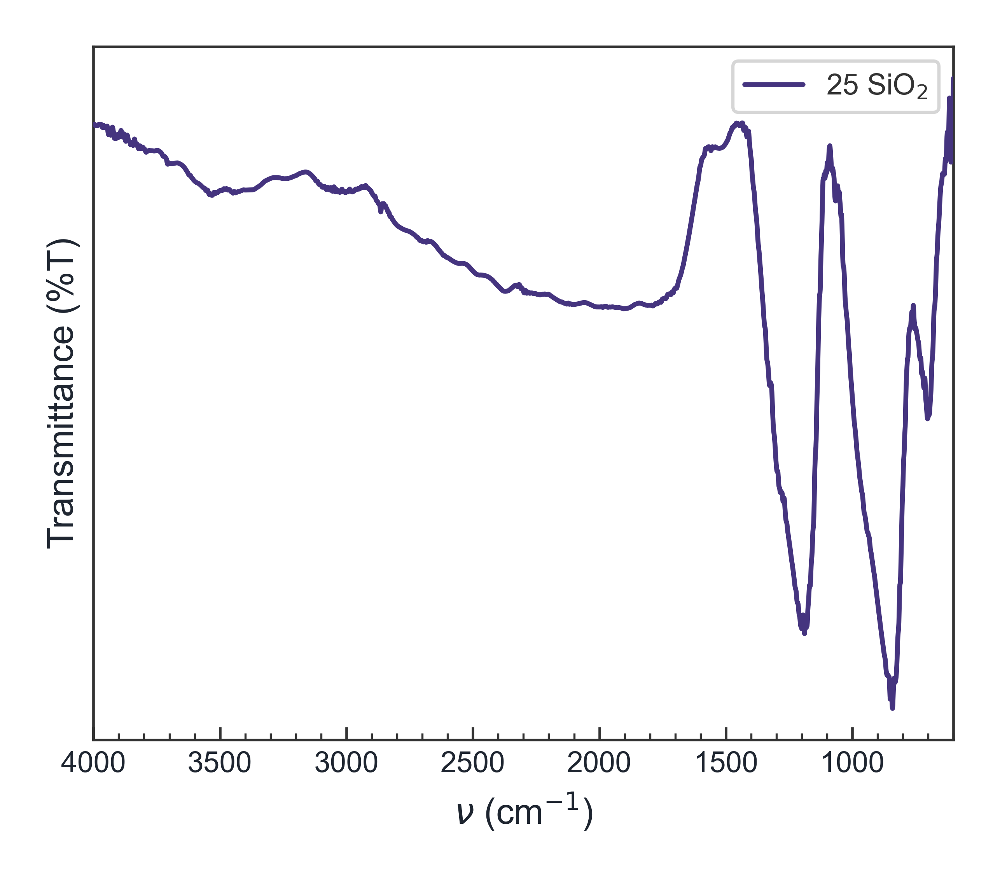
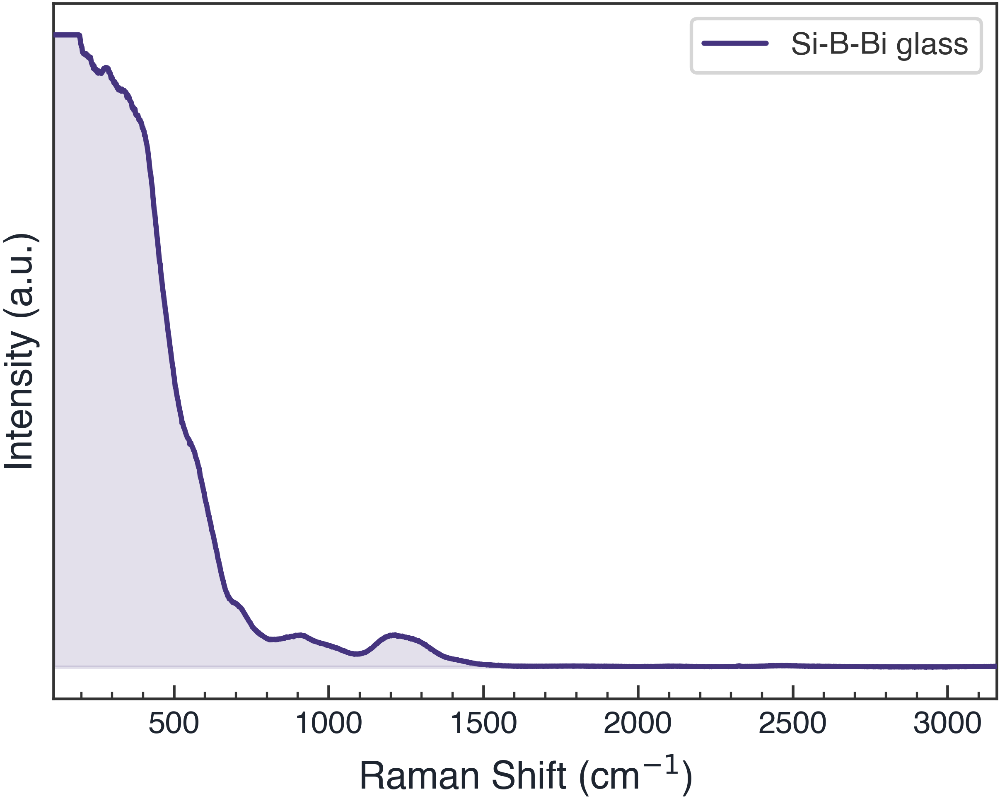

> **Quick answer:** Use overlay for position and shape comparisons, stack or vertical offset for readability, and normalization only when relative shape—not absolute magnitude—is the question. Apply the same preprocessing rule to every sample and disclose it in the caption or method.

## The plotting mode can change what the reader thinks the data shows

With two spectra, overlay is usually straightforward. With ten or twenty, traces hide one another, legends become crowded, and a small baseline difference can look like a material effect.

The main decision is not which layout looks best. It is which layout makes the comparison honest and easy to read.

This page focuses on **multi-sample display choices**. For a broader workflow covering FTIR and Raman preprocessing and publication figures, see [How to Process FTIR and Raman Spectra](../ftir-raman-spectra-analysis/).

## Overlay, stack, offset, or normalize?

| View | Best for | Main risk |
|---|---|---|
| Overlay | Peak shifts, edge shifts, direct shape comparison | Weak traces can be hidden |
| Stack | Reading many samples separately | Visual separation can obscure small shifts |
| Vertical offset | Controlled separation with a shared x-axis | Offset can be mistaken for intensity change |
| Normalize + overlay | Relative shape or peak-ratio comparison | Absolute magnitude information is removed |

A useful workflow often creates two versions: an overlay for analysis and a stack for communication.

## Step 1: Validate the axes before combining files

Every trace should use the same physical x-axis and compatible units. Confirm:

- XRD is plotted against 2θ when that is the recorded axis;
- FTIR uses wavenumber in cm⁻¹ and a consistent direction;
- Raman uses Raman shift in cm⁻¹;
- UV-Vis, if included elsewhere, uses wavelength or photon energy as labeled;
- absorbance and % transmittance are not mixed in one overlay.

Do not align curves by stretching an axis merely to make peaks match.

## Step 2: Lock sample order and colors

Order the traces according to the experimental variable: control, composition, temperature, time, or treatment level. Keep that order in the legend and reuse the color mapping across related figures.

The actual workspace below shows six XRD measurements in a single sample list and stacked plotting area.

*Figure 1. Actual application view using sample XRD data. The list, sample order, colors, and stacked traces remain visible together.*

A consistent order matters more than a decorative palette. Readers should not have to relearn which curve represents the control in every panel.

## Step 3: Correct baselines cautiously and consistently

Baseline correction is not a cosmetic operation. It can change broad features, peak areas, and relative intensities.

A defensible approach is to:

1. keep the raw trace;
2. choose one algorithm and parameter rule for comparable samples;
3. inspect broad bands and weak peaks before and after correction;
4. avoid tuning each sample independently just to make the baselines line up;
5. record the method and parameters.

For FTIR transmittance spectra, remember that absorption bands may point downward. A plotting preference should not silently change the underlying signal definition.

## Step 4: Smooth only enough to improve readability

Savitzky–Golay smoothing can reduce high-frequency noise while preserving shape better than a simple moving average, but the window must remain small relative to the features of interest.

If a weak peak appears only after aggressive smoothing, treat it as a warning rather than a discovery. Peak detection should be checked against the raw data.

## Step 5: Normalize only for a stated reason

Normalization can answer questions such as:

- Did a peak shift?
- Did the relative shape change?
- Did one band grow relative to a chosen reference band?

It cannot support a claim about absolute intensity after the original scale has been removed. State the normalization method—for example, maximum intensity, area, or reference peak—and explain why it matches the comparison.

## What clean single-technique outputs look like

The same manuscript may include separate FTIR and Raman panels rather than forcing different physical quantities onto one axis.

*Figure 2. Example FTIR output generated from sample data. The transmittance axis and wavenumber direction are stated explicitly.*

*Figure 3. Example Raman output generated from sample data. Keep Raman and FTIR in separate labeled panels even though both x-axes may use cm⁻¹.*

## A repeatable Windows workflow

Spectra Studio can load multiple files, maintain a sample list, and switch among overlay, stack, normalization, and vertical offset. Basic multi-sample plotting, preprocessing, peak detection, and PNG/JPG export are available in Free.

The key benefit is consistency: one change to sample order or spacing does not require manually rebuilding every trace in a slide or spreadsheet. The scientific choices—what to normalize, whether to correct the baseline, and which features matter—still belong to the researcher.

## Caption checklist for a multi-sample plot

State:

- whether traces are raw, smoothed, or baseline-corrected;
- whether intensities were normalized;
- the normalization rule;
- whether a vertical offset was added for clarity;
- the sample order and experimental variable;
- any peak labels that are assignments rather than direct measurements.

## Related guides

- [How to Process FTIR and Raman Spectra for a Publication Figure](/en/guides/ftir-raman-spectra-analysis/)
- [How to Make a Publication-Ready XRD Figure Without Origin](/en/guides/xrd-publication-figure-without-origin/)
- [How to Open XRD, FTIR, Raman, and UV-Vis Files](/en/guides/spectra-data-format-conversion/)

## Bottom line

Overlay is for direct comparison; stack and offset are for readability; normalization changes the question the figure can answer. Validate the axes, apply processing consistently, and keep technique-specific quantities in clearly labeled panels.

👉 **Need a faster multi-file plotting workflow?**
[Download Spectra Studio Free and review supported formats](https://hulab.pages.dev/en/spectra-studio)
