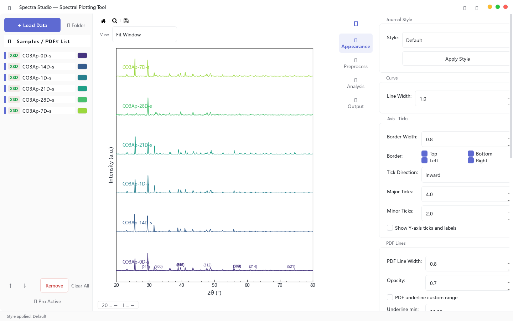
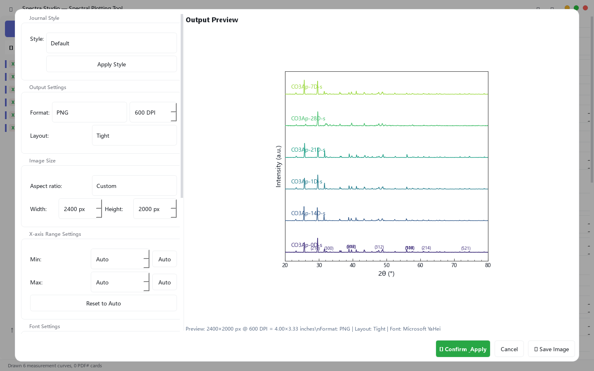
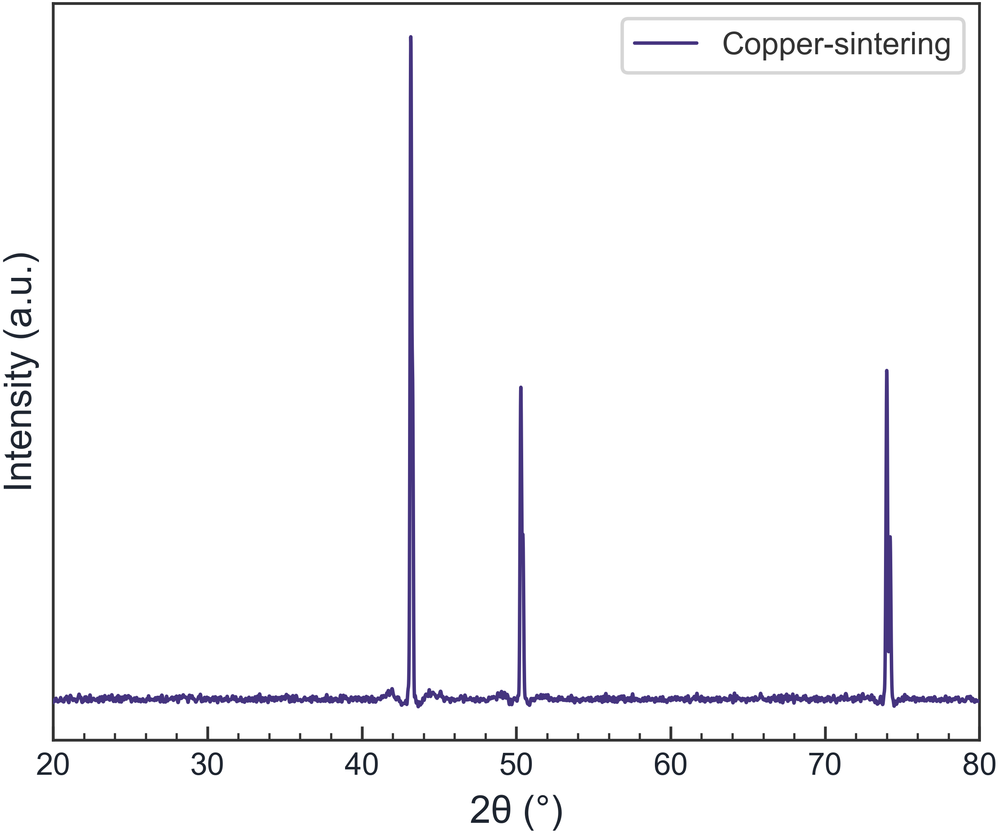

> **Quick answer:** Define one figure system before polishing individual plots: final width, font size, line weight, color mapping, axis style, sample order, and export format. Then apply those rules across XRD, FTIR, Raman, and UV-Vis figures.

## The expensive part is not plotting one curve—it is keeping every figure consistent

A paper rarely contains one spectrum. It may include an XRD stack, an FTIR comparison, a Raman panel, and a UV-Vis or Tauc plot. Each figure can look acceptable on its own while the full manuscript still feels inconsistent.

Common signs of a fragmented workflow include:

- the same sample changes color between figures;
- axis labels use different fonts or unit styles;
- line widths vary because plots came from different applications;
- legends follow different sample orders;
- one panel was exported at screen resolution;
- offsets were adjusted manually and cannot be reproduced after a revision.

The solution is not another round of visual tweaking. It is a small figure specification that you can reuse.

## Write the figure specification first

Before editing individual plots, decide:

| Element | Rule to set once |
|---|---|
| Final size | Single-column or double-column width from the target journal |
| Typography | Font family and minimum readable size at final placement |
| Lines | Primary trace width, fit width, reference-line width |
| Colors | One sample-to-color mapping across all techniques |
| Axes | Border sides, tick direction, unit notation, scientific symbols |
| Multi-sample view | Overlay, stack, or vertical offset—and why |
| Output | Vector format when accepted; required DPI for raster files |

This specification can be short. Its value is that a reviewer-requested sample does not force you to redesign the paper.

## Step 1: Lock the sample order and color mapping

Use the same logical order everywhere: control first, then treatment level, time, temperature, or composition. If the control is navy in XRD, keep it navy in FTIR and Raman unless there is a strong reason not to.

Color should support the experimental design rather than decorate it. A sequential series benefits from a sequential palette; distinct categories need clearly separated colors. Check that the figure remains interpretable in grayscale and for readers with common color-vision deficiencies.

## Step 2: Choose overlay or stack based on the claim

Use **overlay** when the central evidence is a peak shift, an edge shift, or a direct shape comparison. Use **stack or vertical offset** when the traces would otherwise obscure one another.

An offset is a display choice, not a measured change in intensity. State it in the caption when there is any chance of confusion.

The actual interface below shows a six-sample XRD stack with a shared style panel. Sample order, colors, lines, ticks, and borders can be reviewed in the same view.

*Figure 1. Actual application view using sample data. The style controls and the final trace order are visible together.*

## Step 3: Separate data processing from visual formatting

Baseline correction, smoothing, and normalization change the displayed data. Fonts, colors, ticks, and legend placement do not. Keep those decisions separate.

A defensible order is:

1. preserve the raw data;
2. validate the axes and units;
3. apply only justified preprocessing;
4. choose the comparison view;
5. apply the manuscript-wide visual style;
6. export at the final dimensions.

This order makes it easier to explain what changed the data and what changed only the presentation.

## Step 4: Design at the final size

A figure that looks clean at full-screen size may fail after being reduced to a journal column. Review the exported image at its intended placement size. Look for:

- labels below the journal's minimum readable size;
- fit and residual lines that become indistinguishable;
- legends that cover data after resizing;
- peak labels that collide;
- excessive white space around the plotting area.

Do not use a screenshot as the final manuscript figure. Export from the plotting workflow at the required dimensions.

## Step 5: Preview the export, not just the canvas

The export stage should show the selected format, dimensions, resolution, and crop before the file is saved.

*Figure 2. Actual export preview using sample XRD data. The figure is reviewed at the specified output size rather than captured from the screen.*

For line-heavy plots, PDF, SVG, or EPS preserves vectors when the journal accepts them. TIFF or PNG may be required for raster workflows. Follow the target journal's instructions rather than assuming that one DPI value works everywhere.

Here is an example of a clean XRD output generated from sample data:

*Figure 3. Example output. Always replace sample labels and styling with conventions appropriate to your own experiment and target journal.*

## Where a dedicated workflow helps

A spectroscopy-focused tool is useful when repeated work—not custom statistical modeling—is the bottleneck. Spectra Studio keeps multi-file loading, stack and offset controls, journal-style presets, and export settings in one Windows application. Basic plotting and PNG/JPG output are available in the Free version; vector and higher-resolution export are Pro features.

If you only need an XRD-specific walkthrough, see [How to Make a Publication-Ready XRD Figure Without Origin](../xrd-publication-figure-without-origin/). This page instead focuses on keeping multiple techniques visually consistent across one manuscript.

## A final manuscript-level check

Before submission, place all figures next to one another and ask:

- Does each sample keep the same identity and color?
- Are equivalent axes labeled in the same style?
- Are processing choices disclosed in captions or methods?
- Are all labels readable at final size?
- Can the figure be regenerated when one sample changes?

## Related guides

- [How to Make a Publication-Ready XRD Figure Without Origin](/en/guides/xrd-publication-figure-without-origin/)
- [How to Overlay FTIR, Raman, and XRD Spectra](/en/guides/multi-sample-ftir-raman-xrd-comparison/)
- [Spectra Studio: Turn XRD, FTIR, Raman & UV-Vis Data Into Publication-Ready Figures — Without Origin or Python](/en/guides/spectra-studio-guide-en/)

## Bottom line

Publication-quality is not a preset. It is a repeatable specification applied to validated data. Set the rules once, separate preprocessing from styling, and inspect the actual export at final size. That approach saves more time than polishing each figure independently.

👉 **Want to apply the workflow on Windows?**
[Download Spectra Studio Free or review export options](https://hulab.pages.dev/en/spectra-studio)
