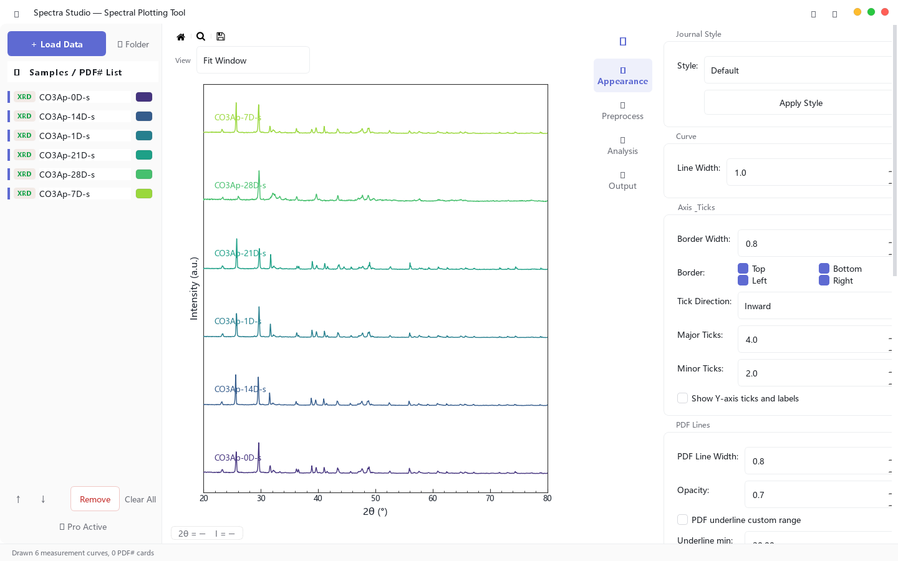

> **Quick answer:** Keep the original instrument export, open it directly when possible, and verify the x-axis, y-axis, units, delimiter, and scan direction before doing any processing. Converting everything to CSV first is convenient, but it can strip context and create another file whose origin must be tracked.

## The analysis should not start with a file-conversion scavenger hunt

A materials lab can generate several valid file types for the same project. An XRD instrument may export `.xrdml`, `.brml`, `.uxd`, `.xy`, `.txt`, `.csv`, or `.dat`. FTIR commonly produces `.asc`, while Raman and UV-Vis instruments often use two-column text or CSV files.

The extension is only the first problem. A file can open successfully and still be interpreted incorrectly because:

- the first column is wavelength rather than wavenumber;
- the XRD axis contains 2θ but is labeled as θ;
- an FTIR spectrum runs from low to high wavenumber when the lab expects the reverse;
- the signal is transmittance, reflectance, absorbance, or raw intensity;
- commas, tabs, decimal separators, or header rows are parsed incorrectly.

The safest workflow is not “convert first and inspect later.” It is “preserve first, inspect during import, and process only after the axes make physical sense.”

## What each common format usually contains

| Technique | Common files | What to verify immediately |
|---|---|---|
| XRD | `.xrdml`, `.brml`, `.uxd`, `.xy`, `.txt`, `.csv`, `.dat` | 2θ range, intensity column, wavelength metadata, header rows |
| FTIR | `.asc`, text, CSV | wavenumber direction, absorbance vs. %T, units in cm⁻¹ |
| Raman | `.txt`, `.xy`, `.csv` | Raman shift, intensity units, cosmic-ray spikes, delimiter |
| UV-Vis | `.txt`, `.xy`, `.csv` | wavelength in nm, absorbance vs. transmittance or reflectance |

An extension alone cannot guarantee the column meaning. Instrument vendors and individual labs can export different layouts under the same generic extension.

## A five-check import test

Before smoothing, baseline correction, normalization, or peak detection, answer these five questions:

1. **Does the x-axis range match the technique?** A UV-Vis scan around 200–900 nm should not be interpreted as Raman shift.
2. **Does the y-axis represent the quantity you intend to analyze?** Absorbance and % transmittance are not interchangeable labels.
3. **Is the scan direction intentional?** FTIR figures are often displayed from high to low wavenumber.
4. **Did the parser keep every data row?** Check the first, middle, and last few points against the original export.
5. **Is the raw file still untouched?** Never overwrite the only instrument export with a processed version.

This short check catches more errors than relying on a plot that merely “looks about right.”

## Direct loading reduces unnecessary copies

A local desktop workflow can keep several techniques in the same sample list without forcing every file through an intermediate spreadsheet. The screenshot below shows actual XRD files loaded together in the application, with the sample names and stacked traces visible in one workspace.

*Figure 1. Actual application view using sample XRD data. The original files remain separate while the traces are organized in one workspace.*

Spectra Studio can directly read the XRD formats listed above and common two-column FTIR, Raman, and UV-Vis exports. After loading, you can check the curves before choosing overlay, stack, vertical offset, smoothing, baseline correction, or peak detection.

The practical benefit is not that file validation disappears. It is that you can validate and organize the data without first creating a second set of converted files.

## When conversion to CSV still makes sense

CSV is useful when you need to:

- share data with collaborators who use another platform;
- archive a simple, documented two-column representation;
- feed a validated dataset into Python, R, MATLAB, or another statistical workflow;
- combine the spectrum with metadata in a reproducible pipeline.

If you convert, keep three items together: the original export, the converted file, and a short note describing columns, units, delimiter, and any rows removed. A file named `sample_final_v3.csv` is not a data-management strategy.

## Keep preprocessing separate from file repair

Do not use smoothing or baseline correction to hide a bad import. If a curve is mirrored, truncated, offset by several orders of magnitude, or missing a region, return to the delimiter, header, and column assignments first.

Once the import is correct:

- use **overlay** for peak-position and shape comparisons;
- use **stack or vertical offset** when traces cover one another;
- use **Savitzky–Golay smoothing** carefully for high-frequency noise;
- use **ALS baseline correction** only after checking broad features;
- keep a raw-data view for comparison.

## How this page differs from the main product guide

This page answers a narrow search question: how to open and verify common spectroscopy and diffraction files without losing track of the original data. For the full interface, supported analysis tools, pricing, and download options, use the [Explore Spectra Studio and download Free](https://hulab.pages.dev/en/spectra-studio/).

## Related guides

- [How to Process FTIR and Raman Spectra for a Publication Figure](/en/guides/ftir-raman-spectra-analysis/)
- [How to Overlay FTIR, Raman, and XRD Spectra](/en/guides/multi-sample-ftir-raman-xrd-comparison/)
- [Spectra Studio: Turn XRD, FTIR, Raman & UV-Vis Data Into Publication-Ready Figures — Without Origin or Python](/en/guides/spectra-studio-guide-en/)

## Bottom line

A file that opens is not automatically a file that was interpreted correctly. Preserve the original export, verify the physical meaning of both axes, and separate import problems from preprocessing decisions. Once those checks pass, a shared local workspace can remove much of the repetitive conversion and copy-and-paste work.

👉 **Need a Windows tool for the workflow?**
[Download Spectra Studio Free and review the supported formats](https://hulab.pages.dev/en/spectra-studio/)
