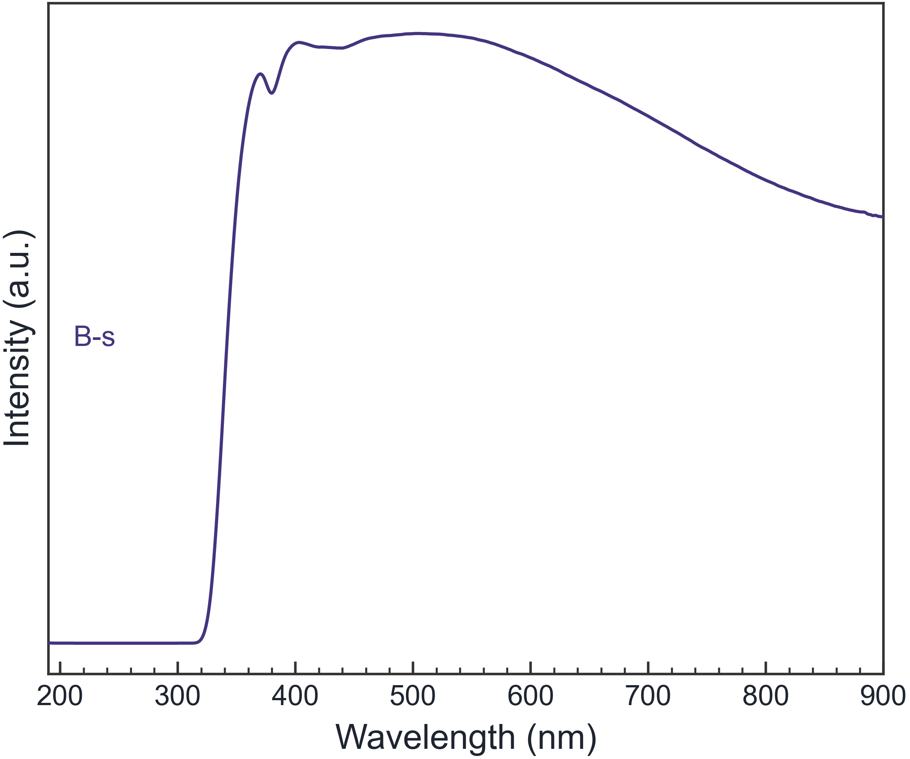
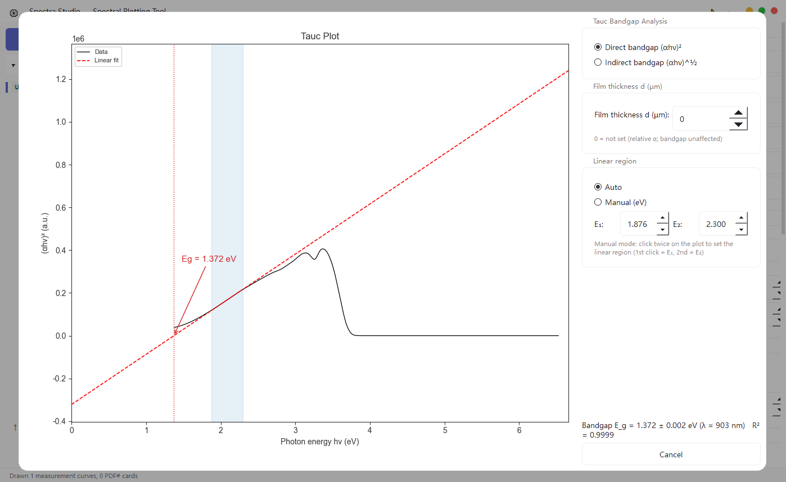

> **Quick answer:** A Tauc result changes when the transition model, absorption conversion, or fitted linear region changes. Treat Eg as a model-dependent optical estimate, test reasonable fit windows, and report the plotted quantity and selected range—not only the intercept.

## The same spectrum can produce several plausible-looking straight lines

A Tauc plot converts an optical spectrum into a form where part of the absorption edge may appear linear. The temptation is to select the straightest-looking segment, extrapolate to the energy axis, and report the intercept as Eg.

That process can produce a precise-looking number while hiding four judgment calls:

1. Was the input absorbance, absorption coefficient, or diffuse reflectance transformed correctly?
2. Was a direct or indirect transition model used?
3. Which points defined the “linear” region?
4. Did defect states, an Urbach tail, scattering, or a second transition affect the edge?

This page focuses on **fit-window sensitivity and reporting**. For the basic wavelength-to-energy steps and Tauc equations, see [How to Draw a UV-Vis Tauc Plot](../uv-vis-tauc-plot-bandgap/).

## State the plotted quantity explicitly

For commonly used allowed-transition forms:

- a direct transition is often evaluated with `(αhν)²` versus `hν`;
- an indirect transition is often evaluated with `(αhν)^(1/2)` versus `hν`.

Conventions for the exponent symbol vary across publications, which is another reason to write the actual plotted axes instead of reporting only “a Tauc plot was used.”

The transition type should be supported by the material literature, electronic-structure evidence, or complementary measurements. Do not choose direct or indirect solely because one line has a larger R².

## Start with the correct optical quantity

For a film measured in absorbance, a common conversion is:

```text
α = 2.303A / d
```

where `A` is absorbance and `d` is thickness in a consistent length unit.

For a strongly scattering powder measured by diffuse reflectance, absorbance-based treatment may not be appropriate. A Kubelka–Munk transformation is commonly considered, but its assumptions and sample preparation still need to be stated. Transmittance, absorbance, and reflectance are not interchangeable inputs.

The original UV-Vis curve should remain available beside the transformed plot:



*Figure 1. Example UV-Vis output from sample data. Inspect the absorption edge and any secondary features before selecting a Tauc model.*

## Why the fit range changes Eg

A real absorption edge is rarely perfectly linear. Moving either endpoint can change the slope and intercept because different regions may contain:

- low-energy noise;
- an Urbach tail from disorder or defects;
- excitonic structure;
- thickness or baseline errors;
- multiple optical transitions;
- saturation or flattening at high absorbance.

A single automatic range is therefore a starting point, not an uncertainty analysis.

## A better fit-window test

### Step 1: Identify the physical edge on the original spectrum

Do not begin from the transformed plot alone. Confirm which spectral feature is expected to represent the transition of interest.

### Step 2: Choose a defensible central window

Select a region that appears approximately linear and is not dominated by the low-energy tail or the high-energy rollover.

### Step 3: Move each endpoint slightly

Repeat the fit with several nearby windows. Record how much Eg changes. If small endpoint changes produce a large shift, report that sensitivity rather than quoting only the regression error from one line.

### Step 4: Compare models only when both are scientifically plausible

A higher R² does not establish the transition type. Use model comparison as a diagnostic, not as a substitute for material knowledge.

### Step 5: Report the range and transformed axis

A reader should be able to reconstruct what was fitted. Report the direct or indirect form, the energy interval, the optical input, thickness or reflectance treatment, and the resulting Eg.

## What an actual analysis screen should show

A useful Tauc workflow keeps the transformed curve, fit line, fit region, direct/indirect selection, and estimated intercept visible together. The screenshot below is an actual analysis view with automatic and manual range controls.



*Figure 2. Actual application view using sample UV-Vis data. The highlighted range and the direct/indirect choice remain visible with the intercept.*

Spectra Studio Pro can generate the direct or indirect transform, suggest a range, and let you set manual endpoints. That saves spreadsheet work, but the selected range and transition model still require scientific justification.

## Do not overstate what Eg means

A Tauc intercept is an optical, model-dependent estimate. It is not automatically identical to a fundamental electronic band gap measured or calculated by another method. Disorder, excitons, defects, scattering, and multiphase samples can all make the comparison more complicated.

Use language such as “the Tauc-estimated optical gap was…” and describe the assumptions. Avoid presenting several decimal places when the fit-window choice changes the result by tenths of an electron volt.

## Reporting checklist

Include:

- original measurement mode: absorbance, transmittance, or diffuse reflectance;
- conversion to α or Kubelka–Munk treatment;
- film thickness and units, if used;
- direct or indirect plotted quantity;
- selected photon-energy range;
- fit quality and fit-window sensitivity;
- estimated Eg with an uncertainty appropriate to the analysis;
- the distinction between a Tauc optical estimate and other gap definitions.

## Related guides

- [How to Draw a UV-Vis Tauc Plot and Estimate Band Gap](/en/guides/uv-vis-tauc-plot-bandgap/)
- [Perovskite Solar Cells: The Material Engineering Behind Record Efficiencies](/en/guides/perovskite-solar-materials/)
- [How to Open XRD, FTIR, Raman, and UV-Vis Files](/en/guides/spectra-data-format-conversion/)

## Bottom line

If Eg changes when you drag the fit window, the software is not necessarily broken—the analysis is exposing a model choice. Test several reasonable ranges, keep the original spectrum visible, and report enough information for another researcher to reproduce the intercept.

👉 **Need automatic and manual Tauc range controls?**
[Review Spectra Studio Tauc analysis and download options](https://hulab.pages.dev/en/spectra-studio/)
