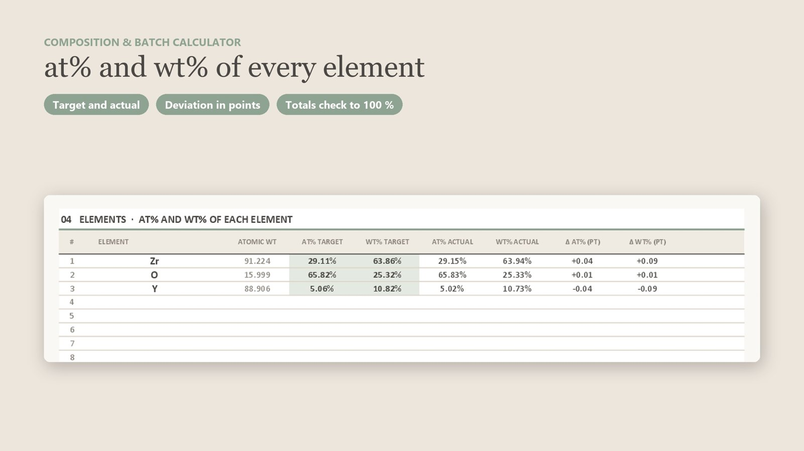
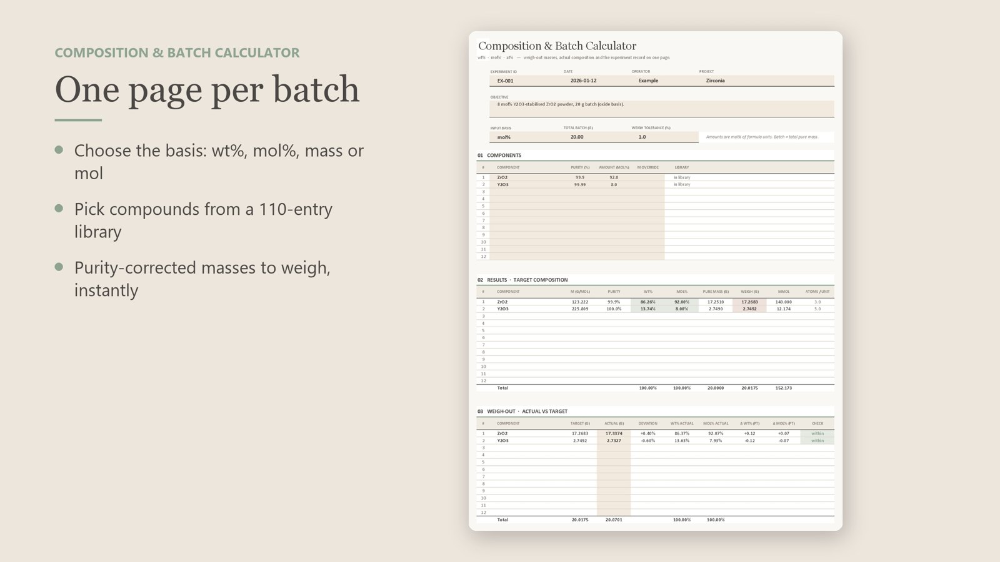

> **Quick answer:** To go from **mol% to wt%**, multiply each mole fraction by its molar mass and normalise: wᵢ = xᵢMᵢ / Σ xⱼMⱼ. To go from **wt% to mol%**, divide each mass fraction by its molar mass and normalise: xᵢ = (wᵢ/Mᵢ) / Σ (wⱼ/Mⱼ). The **mass to weigh** is the pure mass divided by the purity: 17.2510 g of ZrO₂ at 99.9 % purity means weighing **17.2683 g**. You can run every example below with the free [batch_calc.py](/downloads/batch_calc.py) script.

Weighing out a batch looks simple until a reviewer asks whether "8 mol% Y₂O₃" means oxide or cation basis, or a sintered pellet comes out slightly off-stoichiometry because nobody corrected for the 99.5 % purity on the bottle. This guide covers the conversions, the corrections that are easy to forget, and how to check what you actually weighed.

## The three formulas you need

All batch maths comes down to moles. For each component *i* with molar mass Mᵢ (g/mol):

| You have | You want | Formula |
|---|---|---|
| mol% (xᵢ) | wt% (wᵢ) | wᵢ = xᵢMᵢ / Σ xⱼMⱼ |
| wt% (wᵢ) | mol% (xᵢ) | xᵢ = (wᵢ/Mᵢ) / Σ (wⱼ/Mⱼ) |
| pure mass mᵢ, purity p | mass to weigh | mᵢ / p |

The batch size is usually the **total mass of pure material** (for example 20 g of finished oxide powder). Multiply each wt% by that total to get the pure mass, then correct for purity.

Molar masses should come from standard atomic weights, not from rounded textbook values: Y₂O₃ is 2 × 88.906 + 3 × 15.999 = **225.809 g/mol**. Rounding it to 226 already moves the third decimal of every mass.

## Example 1: 8 mol% Y₂O₃–ZrO₂ (20 g, mol% basis)

Target: 92 mol% ZrO₂ + 8 mol% Y₂O₃, 20 g of pure powder. Purity: ZrO₂ 99.9 %, Y₂O₃ 99.99 %.

1. Molar masses: ZrO₂ 123.222 g/mol, Y₂O₃ 225.809 g/mol.
2. Weighted sum: 0.92 × 123.222 + 0.08 × 225.809 = 131.429 g/mol.
3. wt%: ZrO₂ = 0.92 × 123.222 / 131.429 = **86.26 wt%**, Y₂O₃ = **13.74 wt%**.
4. Pure masses in 20 g: ZrO₂ **17.2510 g**, Y₂O₃ **2.7490 g**.
5. Mass to weigh: 17.2510 / 0.999 = **17.2683 g** ZrO₂, 2.7490 / 0.9999 = **2.7492 g** Y₂O₃.

```bash
python batch_calc.py --basis mol --total 20 ZrO2:92:99.9 Y2O3:8:99.99
```

| Component | M (g/mol) | mol% | wt% | Pure (g) | Purity | **Weigh (g)** |
|---|---|---|---|---|---|---|
| ZrO₂ | 123.222 | 92.00 | 86.26 | 17.2510 | 99.9 % | **17.2683** |
| Y₂O₃ | 225.809 | 8.00 | 13.74 | 2.7490 | 99.99 % | **2.7492** |

**Mind the basis.** 8 mol% Y₂O₃ is **not** 8 % yttrium on the cation sites. Each Y₂O₃ brings two Y, so the cation fraction is 2 × 8 / (92 + 2 × 8) = **14.81 mol% YO₁.₅**. Papers use both conventions ("8YSZ" is the oxide basis), so state yours in the Experimental section.

## Example 2: BaTiO₃ from BaCO₃ and TiO₂ (precursor basis)

Often you weigh precursors that decompose. For 10 g of BaTiO₃ by solid-state reaction, BaCO₃ + TiO₂ → BaTiO₃ + CO₂:

1. Moles of product: 10 / 233.194 = **0.042883 mol**.
2. BaCO₃: 0.042883 × 197.338 = 8.4624 g pure → at 99.8 % purity weigh **8.4794 g**.
3. TiO₂: 0.042883 × 79.865 = 3.4248 g pure → at 99.6 % purity weigh **3.4386 g**.
4. Check: the precursors total 11.8872 g pure, and 1.8872 g leaves as CO₂ (0.042883 × 44.009), leaving 10 g of BaTiO₃.

The common mistake is to calculate the batch on the oxide basis (BaO + TiO₂) and then weigh BaCO₃ grams equal to the BaO grams. That leaves the product about 22 % short of barium.

## Example 3: a borosilicate glass from wt% (wt% to mol%)

Glass recipes are often given in wt%. For 80 SiO₂ – 13 B₂O₃ – 4 Na₂O – 3 Al₂O₃ (wt%), 50 g batch:

```bash
python batch_calc.py --basis wt --total 50 SiO2:80 B2O3:13 Na2O:4 Al2O3:3
```

| Oxide | wt% | M (g/mol) | **mol%** | Pure (g) |
|---|---|---|---|---|
| SiO₂ | 80.00 | 60.083 | **82.59** | 40.0000 |
| B₂O₃ | 13.00 | 69.617 | **11.58** | 6.5000 |
| Na₂O | 4.00 | 61.979 | **4.00** | 2.0000 |
| Al₂O₃ | 3.00 | 101.961 | **1.83** | 1.5000 |

Al₂O₃ is 3 wt% but only 1.83 mol%, because it is heavy. If your structural argument is per mole (network formers, NBO/T), convert first. In practice Na₂O and B₂O₃ go in as Na₂CO₃ and H₃BO₃: work out the moles of each oxide, then weigh the precursor that supplies them, as in Example 2.

## Hydrates: the error that hides in the formula

Nitrate and chloride precursors carry water of crystallisation. To supply the 2.7490 g of Y₂O₃ from Example 1 with yttrium nitrate hexahydrate:

- Moles of Y needed: 2 × 2.7490 / 225.809 = 0.024348 mol.
- Y(NO₃)₃·6H₂O has M = 383.008 g/mol, so weigh **9.3255 g**.

Using anhydrous Y(NO₃)₃ (274.92 g/mol) by mistake gives 6.69 g, about 28 % too little yttrium. Check the formula on the bottle, and remember that hygroscopic salts gain water once opened. Dry them, or titrate the metal content, when it matters.

## From the formula to at% and wt% of each element

EDS, XPS and ICP report elements, not compounds. To compare, convert the batch to element fractions: multiply the moles of each compound by its atom counts, sum per element, then normalise by atoms (at%) or by mass (wt%). For Example 1:

| Element | at% | wt% |
|---|---|---|
| Zr | 29.11 | 63.86 |
| O | 65.82 | 25.32 |
| Y | 5.06 | 10.82 |

Oxygen is hard to quantify by EDS, so compare cation ratios: Y/(Y + Zr) = 5.06 / 34.17 = 14.8 %, the same 14.81 % as the YO₁.₅ basis above.



## Check what you actually weighed

Nobody hits 17.2683 g exactly. Write down the real masses and recompute the composition from them. That is the composition you made, and the one you should report. With 17.3374 g ZrO₂ and 2.7327 g Y₂O₃:

| | Target (g) | Actual (g) | Deviation | Actual wt% | Actual mol% |
|---|---|---|---|---|---|
| ZrO₂ | 17.2683 | 17.3374 | +0.40 % | 86.37 | 92.07 |
| Y₂O₃ | 2.7492 | 2.7327 | −0.60 % | 13.63 | 7.93 |

A 0.6 % weighing error on the dopant moves it by 0.07 mol%, which is fine for 8YSZ. For a 0.5 mol% dopant the same mistake is a much larger relative change. Set a tolerance per component and re-weigh when it is exceeded.

## Common mistakes checklist

- Batch size defined as precursor mass instead of product mass (or the other way round). Write down which.
- Purity ignored, or applied the wrong way (multiply instead of divide).
- Oxide basis versus cation basis not stated (8 mol% Y₂O₃ = 14.81 mol% YO₁.₅).
- Carbonate, nitrate or hydroxide weighed as if it were the oxide.
- Hydrate water missing from the molar mass, or water picked up after the bottle was opened.
- Loss on ignition, volatilisation (Na, K, Bi, Pb, B) and moisture not corrected for.
- Rounded molar masses, or a typo copied from batch to batch in a hand-made spreadsheet.
- Nominal rather than actual composition reported.

## Do it in Excel instead

The [batch_calc.py](/downloads/batch_calc.py) script is free and handles the conversions above. If you prefer a spreadsheet that also keeps the lab record, the **[Composition & Batch Calculator](https://jerryhome6.gumroad.com/l/composition-batch-calculator)** ($4.99) puts it on one Excel page per batch:

- Input in wt%, mol%, grams or moles, up to 12 components, each with its own purity.
- Purity-corrected masses to weigh, mmol and atoms per formula unit.
- **Weigh-out check:** type the actual masses to see the deviation, actual wt% and mol%, and a within / check flag against your tolerance.
- Element at% and wt%, target and actual side by side.
- A library of 110 compounds with molar masses from 118 atomic weights, an experiment log, and the three examples from this guide. No macros.



It and the other research kits are listed in the [shop](/en/shop/).

## FAQ

### How do I convert wt% to mol%?

Divide each weight fraction by the compound's molar mass to get relative moles, then divide each by their sum. For 80 wt% SiO₂ with 13 B₂O₃, 4 Na₂O and 3 Al₂O₃, SiO₂ becomes 82.59 mol%.

### Should the batch size be the mass of the product or of the raw powders?

Either works if you are consistent, but the product (pure oxide) mass is easier to compare between batches. With carbonates or hydrates the raw powders weigh more than the product because CO₂ or water leaves on heating.

### How do I correct for purity when weighing?

Divide the required pure mass by the purity as a fraction. 17.2510 g of pure ZrO₂ at 99.9 % purity means weighing 17.2510 / 0.999 = 17.2683 g.

### What is the difference between 8 mol% Y₂O₃ and 8 mol% Y?

8 mol% Y₂O₃ is on the oxide basis. Each Y₂O₃ contains two yttrium atoms, so the cation fraction Y/(Y + Zr) is 14.81 %. State which basis you use.

### Can I calculate at% of each element from the formula?

Yes. Multiply the moles of each compound by its atom counts, sum per element, and divide by the total number of atoms. 8 mol% Y₂O₃–ZrO₂ gives 29.11 at% Zr, 65.82 at% O and 5.06 at% Y.
