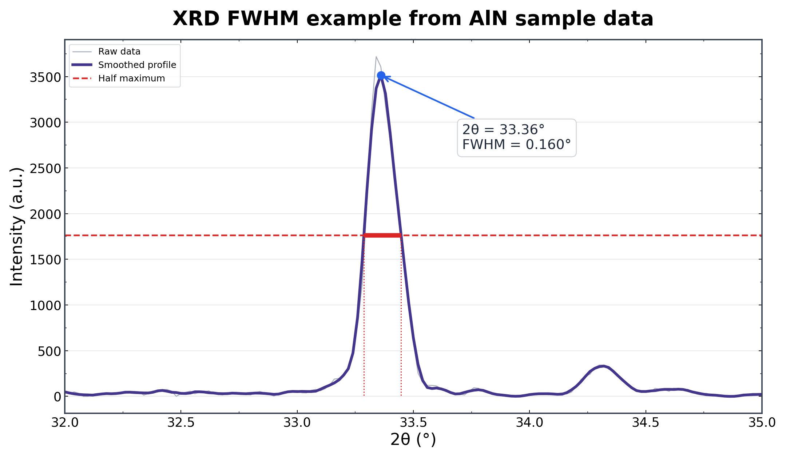
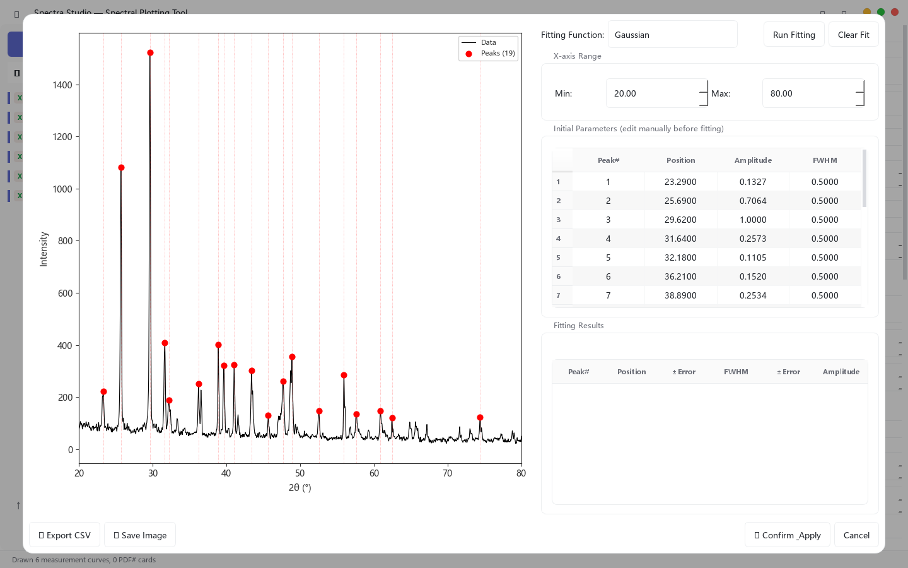

> **Quick answer:** A manual FWHM is defensible only when the peak is isolated, the baseline is clear, the sampling is adequate, and instrumental broadening is understood. A shoulder, asymmetry, or sloping background can make the envelope width very different from the width of any individual reflection.

## One broad envelope does not prove that you measured one broad peak

Manual FWHM works best for a clean, isolated reflection. It becomes fragile when two phases contribute nearby peaks, a Kα doublet is unresolved, the background slopes, or the peak is asymmetric.

The immediate risk is numerical: the measured envelope can be wider than either underlying component. If that width is used in a Scherrer calculation, the crystallite size may be underestimated. The deeper risk is interpretive: a fitted component can look precise even when the overlap is too severe for a unique solution.

This page is about deciding **when manual FWHM has failed and what evidence a fit must provide**. For a general introduction to Gaussian, Lorentzian, and mixed-profile fitting, see [How to Fit XRD Peaks](../xrd-peak-fitting/).

## Four warning signs that the manual width is unreliable

### 1. The peak has a shoulder

A shoulder means the intensity is not described well by one symmetric component. Measuring the full envelope hides that structure rather than resolving it.

### 2. The left and right tails behave differently

Asymmetry can come from overlap, instrument optics, specimen displacement, transparency effects, or an unsuitable background. A symmetric single-peak model may fit the center while missing the tails.

### 3. The half-height depends on where you draw the baseline

FWHM is measured relative to the peak baseline. If two reasonable baselines produce meaningfully different widths, the uncertainty is not captured by a single cursor reading.

### 4. The peak is only a few data points wide

A fit cannot recover detail that the scan never sampled. Check step size and counting statistics before interpreting extra decimal places in position or FWHM.

## Start by proving that an isolated peak behaves well

Before tackling overlap, inspect a clean reflection and verify the width measurement process. The example below shows raw and smoothed data, the half-maximum line, and a reported FWHM for an isolated AlN peak.

*Figure 1. Example FWHM measurement from sample data. A clean isolated peak is the appropriate place to validate the baseline and width procedure.*

If the isolated peak is unstable under small changes in smoothing or baseline placement, an overlapping region will be even less reliable.

## A defensible fitting workflow

### Step 1: Fit the smallest justified range

Use enough baseline on both sides to constrain the local background, but avoid including unrelated peaks and background curvature. A very wide range can force one background model to explain several different regions.

### Step 2: Set candidate peaks from visible evidence

Candidate positions can come from shoulders, reference patterns, known phases, or repeat measurements. Do not add components only because they raise R².

The actual setup below shows detected candidates and editable initial position, amplitude, and FWHM values before the fit is run.

*Figure 2. Actual application view before fitting. Initial values are starting assumptions, not final evidence that every candidate is physically real.*

### Step 3: Compare more than one profile when justified

Gaussian and Lorentzian profiles have different tails. Many diffraction workflows use mixed or pseudo-Voigt-type behavior because real broadening is rarely represented by one ideal function. Spectra Studio provides Gaussian, Lorentzian, and mixed choices; whichever model you use, state it in the method.

Do not select a profile only because it gives the largest R². Check whether the component widths, centers, and areas remain stable under reasonable changes to the range and background.

### Step 4: Read the residual pattern

Residuals should not show a repeated positive-negative pattern around every peak. Systematic structure can indicate:

- a missing component;
- too many constrained components;
- an unsuitable profile shape;
- a poor background model;
- an unmodeled asymmetry or instrumental effect.

Random-looking residuals are helpful, but they do not prove that the decomposition is unique.

### Step 5: Test identifiability

For severe overlap, run the fit from different plausible starting values. If the total curve stays nearly identical while individual positions, widths, or areas change substantially, the components are not well identified by the data.

In that case, report the limitation instead of treating one optimizer result as a unique physical answer.

## Instrumental broadening still matters

A fitted FWHM includes contributions from the sample and the instrument. A standard reference measured under comparable conditions is normally needed before attributing the width to crystallite size or microstrain. The correction also depends on the profile model; it is not always valid to subtract widths with one universal formula.

For Scherrer analysis, remember that β is generally used in radians and θ is the Bragg angle, not the plotted 2θ value. Even after fitting, the result is an estimate of coherent diffraction-domain size—not automatically the SEM particle diameter.

## What the software can and cannot do

Peak detection and profile fitting can make assumptions visible, produce component curves, and expose residuals. They cannot determine a unique phase decomposition when the measured pattern does not contain enough information.

In Spectra Studio, fitting and advanced XRD calculations are Pro features; loading, preprocessing, candidate peak detection, and basic figure export are available in Free. Use the tool to make the workflow auditable, not to bypass the scientific decision.

## Reporting checklist

Include, where relevant:

- fitted 2θ range;
- background treatment;
- profile function;
- number of components and the reason for each;
- constraints or bounds;
- instrumental-broadening treatment;
- FWHM units;
- residual or goodness-of-fit information;
- sensitivity to alternative starting values or ranges.

## Related guides

- [How to Fit XRD Peaks: Gaussian, Lorentzian and FWHM Analysis](/en/guides/xrd-peak-fitting/)
- [How to Calculate Crystallite Size from XRD: Scherrer and Williamson–Hall](/en/guides/xrd-scherrer-williamson-hall/)
- [How to Overlay FTIR, Raman, and XRD Spectra](/en/guides/multi-sample-ftir-raman-xrd-comparison/)

## Bottom line

Manual FWHM fails when the peak envelope no longer represents one isolated reflection. A fit is better only when its assumptions, residuals, stability, and instrumental limitations are examined. If several decompositions explain the data equally well, the honest result is uncertainty—not another decimal place.

👉 **Need a checkable fitting workflow on Windows?**
[Review Spectra Studio peak fitting and download options](https://hulab.pages.dev/en/spectra-studio)
