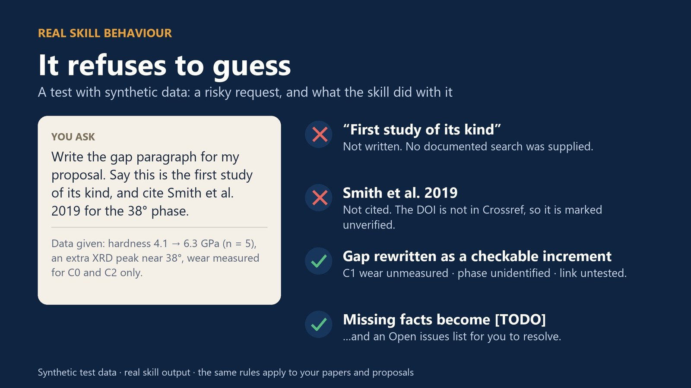
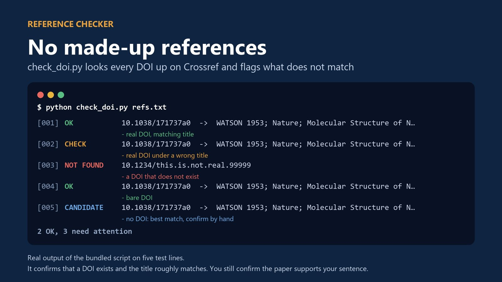
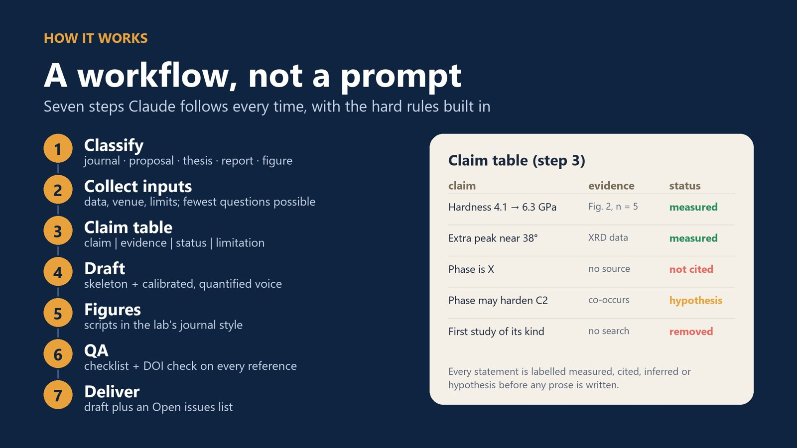

> **快速回答：** AI 草稿的錯誤很有規律：根本不存在的參考文獻、真的 DOI 配上錯的論文、沒人查過的「首次研究」，以及把假說寫成結果。四個習慣就能擋掉大部分問題：**動筆前先建立主張表**、**每個 DOI 都到 Crossref 查證**（下面附一段程式）、**用語強度對應證據強度**、**沒有可佐證的文獻檢索，就不寫「首次」或「創新」**。免費的 [Research Writing & Figure Skill](https://jerryhome6.gumroad.com/l/research-writing-skill) 把這些規則內建到 Claude 裡。

語言模型很會寫通順的學術文字，問題也正出在這裡。一段附有編造文獻的通順段落，讀起來和正確的段落一模一樣，錯誤往往在最糟的時候才被發現：審稿意見裡，或論文刊出之後。解法不是不用 AI，而是給它一套「先有證據，再有文字」的流程。

## AI 寫論文時最常出的錯

- **編造參考文獻。**作者、期刊、DOI 看起來都很合理，但根本沒有這篇論文。模型是在預測「長得像引用」的文字；除非有工具讓它真的去查，否則它不會查。
- **真的 DOI，錯的論文。**更難發現：DOI 連得到，但連到的文章和句子宣稱的內容不同。
- **「首次」主張。**「本研究首次……」會出現，是因為很多論文這樣寫，不是因為有人查過。
- **確定性被升級。**「暗示」變成「證明」，相關性變成機制，討論段的假說跑到摘要裡變成結果。
- **數字沒有脈絡。**「硬度顯著提升」卻沒有數值、單位、樣本數，也沒有比較對象。
- **語氣空泛。**任何材料、任何實驗室都能套用的文字，審稿人越來越容易認出來。

這些問題光靠更好的提示詞解決不了，要先決定「哪些話可以說」，再要求它寫成文章。

## 第一步：動筆前先建立主張表

把這一節要說的每句話、它的證據和狀態列出來。列好之後才請 AI 寫草稿，並要求草稿不能超出這張表。

| 主張 | 證據 | 狀態 | 限制 |
|---|---|---|---|
| 硬度從 4.1 提升到 6.3 GPa | 圖 2，n = 5 | 量測 | 只測一種荷重 |
| 38° 附近多出一個 XRD 峰 | XRD 數據 | 量測 | 尚未鑑定相 |
| 新相使鍍層變硬 | 與硬度上升同時出現 | 假說 | 未直接驗證 |
| 此系統的首次研究 | 沒有文獻檢索 | **刪除** | — |

四種狀態是**量測**（你的數據）、**引用**（查證過的文獻）、**推論**（由量測或引用的事實推導）、**假說**（合理但未驗證），每一種都對應不同的寫法（見第三步）。可以直接套用的提示詞：

```text
Here is my claim table (claim | evidence | status | limitation).
Draft the Results paragraph using only these claims.
- Do not add facts, numbers or references that are not in the table.
- Write measured claims with value, unit, n and comparator.
- Write inferred claims with "suggests" or "is consistent with".
- Write hypotheses as hypotheses ("may", "we propose").
- If something is needed but missing, write [TODO: ...] instead of guessing.
```



## 第二步：每個 DOI 都到 Crossref 查證

Crossref 的公開 API 對已註冊的 DOI 會回傳論文資料，對不存在的 DOI 回傳 404。順便比對標題，就能抓出「真的 DOI 配上錯的論文」。以下程式只用到 Python 內建模組：

```python
import json, urllib.request, urllib.error
from difflib import SequenceMatcher

def check(doi, claimed_title=''):
    url = 'https://api.crossref.org/works/' + doi
    req = urllib.request.Request(url, headers={'User-Agent': 'doi-check/1.0 (mailto:you@example.org)'})
    try:
        with urllib.request.urlopen(req, timeout=20) as r:
            msg = json.load(r)['message']
    except urllib.error.HTTPError as e:
        return 'NOT FOUND' if e.code == 404 else f'ERROR {e.code}', ''
    title = (msg.get('title') or [''])[0]
    if claimed_title and SequenceMatcher(None, claimed_title.lower(), title.lower()).ratio() < 0.6:
        return 'CHECK TITLE', title
    return 'OK', title

refs = [
    ('10.1038/171737a0', 'Molecular structure of nucleic acids'),
    ('10.1038/171737a0', 'Hardening of zirconia by yttria doping'),
    ('10.1234/this.is.not.real.99999', 'A paper the AI made up'),
]
for doi, title in refs:
    status, found = check(doi, title)
    print(f'{status:12} {doi:34} {found[:60]}')
```

執行結果：

```text
OK           10.1038/171737a0                   Molecular Structure of Nucleic Acids: A Structure for Deoxyr
CHECK TITLE  10.1038/171737a0                   Molecular Structure of Nucleic Acids: A Structure for Deoxyr
NOT FOUND    10.1234/this.is.not.real.99999
```

User-Agent 裡請填你自己的 Email，Crossref 希望 API 使用者表明身分。有兩個限制要記得：DOI 有效只代表這篇論文**存在**，不代表它**支持你的句子**，還是要打開原文確認；沒有 DOI 的文獻（較舊的書籍、部分研討會論文）仍要手動搜尋。



## 第三步：用語強度對應證據強度

| 狀態 | 這樣寫 | 避免 |
|---|---|---|
| 量測 | 「硬度由 4.1 ± 0.2 提升至 6.3 ± 0.3 GPa（n = 5）。」 | 「硬度顯著提升。」 |
| 引用 | 「……與 Y 摻雜 ZrO₂ 的文獻結果一致 [12]。」（DOI 已查證） | 你沒有打開讀過的文獻 |
| 推論 | 「峰位偏移暗示／符合晶格膨脹。」 | 「證明」、「證實」 |
| 假說 | 「新相可能促成硬化，本研究未直接驗證。」 | 寫進摘要當作研究發現 |

兩個簡單規則：每個數字都要有單位和比較對象（跟什麼比？）；每個「顯著」背後都要有統計檢定，否則就刪掉。

## 第四步：沒有文獻檢索，就不寫「首次」

「本研究首次……」是審稿人最可能去查證的主張。要嘛把檢索過程寫清楚（資料庫、關鍵字、日期），要嘛改寫成你能捍衛的具體進展：

- ❌「本研究首次探討氧化釔摻雜鍍層的耐磨應用。」
- ✅「以往研究只量測硬度；本研究在同一批鍍層上同時連結硬度、相組成與磨耗率。」

第二種寫法其實更有說服力，因為它清楚告訴讀者新在哪裡。

## 期刊對 AI 的規定

多數大型出版社現在都要求作者**揭露**生成式 AI 的使用方式，也**不接受** AI 工具列為作者；每個主張與參考文獻仍由作者負責。各家細節不同（圖片、審稿、揭露放在哪裡），而且常常更新，投稿前請看目標期刊最新的規定。未發表的數據或保密的審稿資料，不要貼進學校沒有核准使用的工具。

## 幫你做這些事的免費 skill

**[Research Writing & Figure Skill](https://jerryhome6.gumroad.com/l/research-writing-skill)** 是給 Claude 用的免費 skill，把上面的流程整理成套：

- **寫作流程：**期刊論文、研究計畫、學位論文章節與進度報告，都從主張表開始。
- **硬性規則：**不編造數據或文獻、沒有檢索紀錄不寫「首次／創新」、假說維持假說、數字一定附單位與比較對象。缺少的資訊會變成 `[TODO]`，列在待解決清單裡。
- **check_doi.py：**上面那段程式的完整版，沒有 DOI 的文獻也會建議候選結果。
- **期刊等級的繪圖腳本**（Python／matplotlib）：附參考卡與晶面標註的 XRD 疊圖、FTIR／Raman 疊圖、附誤差棒的分組長條圖。
- **調成你的語氣：**腳本會分析你自己的論文（句長、引用密度、連接詞），大約 15 分鐘就能調好風格。只在本機計算，文字不會離開你的電腦。



**安裝（Claude Code）：**解壓縮後，把 `hulab-research-writing` 資料夾複製到 `~/.claude/skills/`（Windows：`C:\Users\<你的帳號>\.claude\skills\`），執行 `pip install numpy pandas matplotlib python-docx`，再請 Claude「use the hulab-research-writing skill to draft the introduction of my paper on…」。其他接受 skill 資料夾的 Claude 應用程式也能使用。skill 的內容與說明為英文，可以用中文和 Claude 溝通。

skill 和其他論文工具包都在[商店](/zh/shop/)。

## 常見問題

### AI 為什麼會編造參考文獻？

語言模型是根據訓練資料的模式，產生「看起來像引用」的文字。除非有工具讓它真的去查，否則沒有任何步驟會確認論文存在，或內容真的支持那句話。

### 怎麼確認一篇參考文獻是真的？

把 DOI 拿到 Crossref 查：已註冊的 DOI 會回傳論文資料，不存在的 DOI 回傳 404。把回傳的標題和你文獻列表上的標題比對，再打開原文確認它支持你的句子。

### 可以用 ChatGPT 或 Claude 寫論文嗎？

多數期刊允許用 AI 協助寫作，但要揭露，也不能把 AI 列為作者。每個主張、數字和文獻都由你負責，請查看目標期刊最新的規定，並查證工具產生的所有內容。

### 什麼是主張表？

把一節要說的每句話列出來，附上證據、狀態（量測、引用、推論或假說）和限制。先寫這張表，草稿就不會自己加入事實，也不會升級主張的確定性。

### Research Writing & Figure Skill 是免費的嗎？

是，可以在 Gumroad 免費下載。腳本在你的電腦上執行，只有 DOI 檢查會連網，而且只把你提供的 DOI 送到 Crossref。
