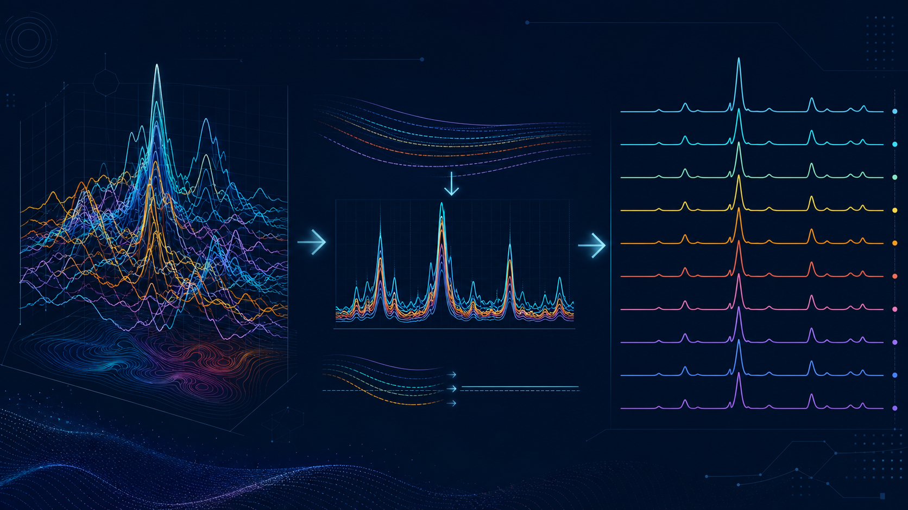

## 樣品少的時候叫疊圖，樣品一多就變成一團線

做一組熱處理、摻雜或不同製程條件的實驗，通常不會只有一個樣品。當 FTIR、Raman 或 XRD 一次出現十幾條曲線，研究者很快會遇到同一個畫面：峰互相蓋住、基線高度不同、樣品名稱找不到、顏色沒有規則，最後只能把圖拆成好幾張，或花時間在繪圖軟體裡逐條整理。

更麻煩的是，這些圖通常還要再改：增加一個對照組、換一個樣品順序、把某組曲線改成 stack、把不同技術的圖排成同一個 figure。若每次都從複製貼上開始，版本很容易失控。

## 多樣品比較最常見的四個痛點

### 1. 不同曲線的基線不在同一個水平

基線漂移可能來自儀器、樣品背景或量測條件。直接 overlay 時，讀者可能把基線差異誤認成訊號差異；但過度校正又可能把真實的寬峰一起扣掉。

### 2. 為了看清楚峰，卻失去樣品之間的關係

Stack 可以讓每條曲線保持可讀，卻可能讓比較峰位移變得不直觀；overlay 能看出共同峰與偏移，卻容易遮住弱峰。顯示方式應該跟研究問題一起決定，而不是所有資料都套同一種圖。

### 3. 樣品名稱、顏色與排序靠手動維護

當樣品增加或重新命名，圖例、顏色和曲線順序常常要一起修改。若不同圖表使用不同顏色邏輯，讀者也會更難把 XRD、FTIR 和 Raman 的結果對照起來。

### 4. FTIR、Raman 和 XRD 的軸不能隨便混用

FTIR 通常以 wavenumber（cm⁻¹）呈現，Raman 以 Raman shift（cm⁻¹）呈現，XRD 則常見 2θ。即使單位看起來相同，物理意義也不同。多技術比較需要清楚標示，不應只因為能放在同一個畫布上，就直接比較絕對訊號強度。

*圖 1｜多樣品光譜從混亂重疊到可讀比較的概念流程；圖片為示意圖，非實際介面。*

## 用 Spectra Studio 依問題選擇圖表方式

### 想比較峰位移：先用 Overlay

Overlay 適合觀察共同峰、峰位偏移與相對形狀。載入多組資料後，先確認所有檔案的軸方向、範圍與單位一致，再進行比較。FTIR 若由不同儀器輸出，尤其要確認 wavenumber 方向是否一致。

### 想逐條閱讀樣品：改用 Stack 或 Vertical Offset

當曲線數量多、峰形重疊嚴重時，Stack 能讓每個樣品保持分離；Vertical offset 則可細調曲線間距，避免圖例與峰形擠在一起。建議保留原始強度資訊，不要把 offset 後的高度當作樣品訊號強弱。

### 想比較相對峰形：再考慮 Normalize

Normalize 適合比較形狀或峰相對位置，但會改變絕對強度的閱讀方式。如果研究問題涉及訊號量、濃度或相對強度，必須先確認正規化是否合理，並在方法中說明。

### 有背景漂移或雜訊：先預覽處理結果

Spectra Studio 提供 Savitzky–Golay smoothing 與 ALS baseline correction。調整參數時，應特別檢查窄峰、寬峰和弱峰；最安全的方式是同時保留原始曲線與處理後曲線，讓每一步都能回溯。

### 想快速建立候選峰：使用 Auto Peak Detection

自動峰偵測可以根據訊號高度與形狀找出候選峰，再由研究者調整 sensitivity。它能減少逐條曲線找峰的時間，但不等於完成 FTIR 官能基或 Raman 峰指認。真正的化學歸屬仍要依材料、文獻與對照樣品判斷。

## 把多種技術放進同一篇論文時，怎麼維持一致？

Spectra Studio 可用 Nature、ACS 或 Elsevier 風格作為 XRD、FTIR、Raman 與 UV-Vis 圖表的共同起點，再個別調整軸標籤、範圍、圖例和 panel 版面。這樣做的好處，是整篇論文的字體、線寬和色彩邏輯比較一致；但不代表不同技術的軸可以省略物理量說明。

建議為每張圖建立簡單規則：

- 同一組樣品在不同技術中盡量沿用相同顏色。
- 圖例順序和實驗條件順序一致。
- XRD、FTIR、Raman、UV-Vis 分別使用正確軸標籤。
- Overlay 與 Stack 的用途寫進圖說或方法。
- 正規化、平滑與基線校正參數留下紀錄。

## Free 版與 Pro 版的使用情境

Free 版可以先完成多格式載入、多樣品 overlay、stack、normalize、vertical offset、smoothing、baseline correction、自動峰偵測，以及無浮水印 PNG/JPG 輸出，適合先把批次資料整理清楚。

如果你還需要 Gaussian、Lorentzian 或 mixed peak fitting、R²、residuals、Tauc bandgap、Scherrer、Williamson–Hall，或 PDF、SVG、EPS、TIFF 等向量與高解析度輸出，則可使用 Pro 功能。

## 一個避免「重新整理十幾次」的工作方式

1. 先以原始檔名建立樣品清單，不要一開始就覆蓋原始資料。
2. 先用 overlay 確認共同峰與軸方向。
3. 再依閱讀需求建立 stack 或 vertical offset 版本。
4. 將 baseline、smoothing、normalize 的設定記錄下來。
5. 最後才統一顏色、圖例、字體與輸出格式。
6. 匯出後用實際論文版面大小檢查小字與細線。

這樣即使增加新樣品，也只需要把它放進既有規則，而不是重新手動繪製整張圖。

## 延伸閱讀

- [FTIR、Raman 光譜怎麼整理？批次疊圖、基線校正與投稿圖輸出](/zh/guides/ftir-raman-spectra-analysis/)
- [不用 Origin 也能做論文級 XRD 圖：Windows 免費軟體完整流程](/zh/guides/xrd-publication-figure-without-origin/)
- [儀器檔案格式太亂怎麼辦？把 XRD、FTIR、Raman、UV-Vis 資料放進同一個工作流程](/zh/guides/spectra-data-format-conversion/)

## 結語：樣品越多，越需要一套可重複的規則

多樣品光譜比較的難點，不只是把所有曲線放在同一張圖，而是讓讀者能看懂差異，同時知道你做過哪些前處理。Spectra Studio 將檔案載入、overlay、stack、normalize、baseline、峰偵測與投稿樣式集中在一個 Windows 工作流程中，讓批次資料不必再靠複製貼上維護。

👉 **免費開始整理 FTIR、Raman、XRD 與 UV-Vis：**
[查看 Spectra Studio 功能與下載方式](https://hulab.pages.dev/zh/spectra-studio)
