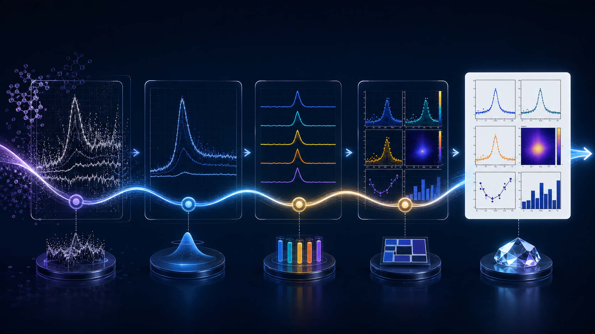

## 你真正想做的是解讀數據，卻被圖例和線寬困住

一張 XRD、FTIR 或 Raman 圖，表面上只是幾條曲線。但只要樣品從兩個增加到十個，工作量就會快速變成另一件事：重新命名檔案、決定曲線順序、安排垂直間距、設定顏色、修正座標軸、移動圖例、調整字型，最後還要確認輸出解析度。

很多研究者會遇到同一個循環：

1. 先在儀器軟體匯出一張圖。
2. 貼到 Origin、Excel 或簡報裡重新排版。
3. 老闆要求樣品順序或顏色調整。
4. 投稿格式改變，所有圖重新做一次。
5. 重新輸出後，發現某條曲線或標籤被裁掉。

問題不是你不會作圖，而是通用繪圖工具把大量重複的光譜工作留給你手動完成。

## 圖表排版的痛點，會直接影響研究效率

### 曲線越多，手動 offset 越容易失控

Overlay 適合比較峰位與形狀，但樣品一多，曲線會互相遮住；改用 stack 或 vertical offset 後，又需要確保每條曲線的間距一致。手動輸入偏移量看似簡單，卻很容易在增加樣品或改變排序時全部重做。

### 正規化、基線與平滑混在一起，版本很難追

為了讓曲線看得清楚，研究者可能會先 normalize，再做 baseline correction，再加上 smoothing。若每一步都在不同軟體完成，最後很難記住哪個版本使用了什麼參數，也不容易把同樣的規則套到下一批樣品。

### 圖片看起來完成，不代表能順利放進論文

螢幕截圖、低解析度 JPG、被裁切的圖例、太小的軸標籤，都是投稿前才會發現的問題。不同期刊對字型、線寬、圖尺寸與檔案格式的要求不同，重新排版往往比最初畫圖還花時間。

*圖 1｜重複排版工作集中在一條流程中；圖片為概念示意，非實際介面。*

## 用 Spectra Studio 把「每張圖重做」改成「同一套規則重複使用」

### 1. 先把多個樣品放在同一個工作區

Spectra Studio 可載入 XRD、FTIR、Raman、UV-Vis 及其他常見資料，並在 sample list 中管理多個檔案。這讓你可以先確認樣品順序與比較目的，再開始調整圖表，而不是開很多視窗互相複製曲線。

### 2. 依比較目的選擇顯示方式

- **Overlay**：適合看 XRD 峰位移、FTIR 官能基變化或 Raman 峰形差異。
- **Stack**：適合樣品很多、需要逐條閱讀峰形的情況。
- **Vertical offset**：控制曲線間距，避免樣品名稱和峰形互相遮住。
- **Normalize**：當你要比較相對形狀，而不是絕對訊號強度時使用。
- **Batch coloring**：按照樣品組別快速配置顏色，讓對照關係更容易讀懂。

這些功能的價值不是讓圖表自動替你做科學結論，而是讓你不用在每次改樣品順序時重新拖曳每條線。

### 3. 用預覽確認前處理沒有改壞峰形

可先預覽 Savitzky–Golay smoothing 與 ALS baseline correction，再決定是否套用到後續圖表。窄峰、寬峰、峰面積和弱訊號都可能對參數敏感，因此建議保留原始資料，並在方法或圖說中記錄處理方式。

### 4. 用期刊風格當作起點，不把它當成投稿保證

Spectra Studio 提供 Nature、ACS 與 Elsevier 風格，可先建立一致的座標軸、字型、線條與圖例基礎。你仍然需要依目標期刊的 author guidelines 檢查：圖幅大小、字體要求、色彩模式、檔案格式、panel 標記與圖說。

### 5. 選對輸出格式，避免最後一步又回到截圖

Free 版可輸出無浮水印 PNG/JPG，最高 300 DPI，適合報告、簡報與初稿。Pro 版可輸出 PDF、SVG、EPS、TIFF 以及較高解析度檔案，當圖中有細線、小字或需要在排版軟體中再調整時，向量格式通常更方便。

## Free 版能不能先解決大部分排版痛點？

可以。若你的主要需求是把資料載入、疊圖、堆疊、正規化、基線校正、峰偵測與 PNG/JPG 輸出做得穩定，Free 版已能完成基本流程，且不會在圖上加浮水印。

只有在需要峰擬合、Scherrer、Williamson–Hall、Tauc bandgap，或期刊指定的向量與高解析度輸出時，再考慮 Pro。這種方式比一開始就為了偶爾使用的進階功能建立複雜腳本，更容易在實驗室內推廣。

## 一個比較不容易返工的作圖檢查表

輸出前可以快速確認：

- 樣品名稱是否與原始檔案和實驗紀錄一致？
- 圖例是否遮住峰或線條？
- offset 或 stack 間距是否一致？
- XRD、FTIR、Raman 與 UV-Vis 的軸標籤是否寫出正確物理量？
- 平滑與基線校正是否讓弱峰消失或產生假峰？
- 所有圖是否使用同一套字體、線寬與顏色邏輯？
- 輸出後用實際尺寸打開，文字是否仍然清楚？

## 延伸閱讀

- [不用 Origin 也能做論文級 XRD 圖：Windows 免費軟體完整流程](/zh/guides/xrd-publication-figure-without-origin/)
- [FTIR、Raman、XRD 多樣品疊圖怎麼不失控？從「一團線」到可讀的比較圖](/zh/guides/multi-sample-ftir-raman-xrd-comparison/)
- [Spectra Studio 光譜分析繪圖工具：把 XRD / FTIR / Raman / UV-Vis 數據變成可直接投稿的論文圖 — 不需要 Origin，也不需要 Python](/zh/guides/spectra-studio-guide/)

## 結語：讓圖表忠實呈現結果，而不是消耗研究時間

論文圖的目的，是讓讀者快速看懂樣品差異與分析結果，不是考驗研究者能否手動調整幾十個圖表選項。Spectra Studio 將多檔載入、overlay、stack、前處理、峰偵測、期刊樣式與輸出放在同一個 Windows 工作流程中，讓你把時間留給數據判讀與論文內容。

👉 **先用自己的資料試跑一次：**
[查看 Spectra Studio 功能與下載方式](https://hulab.pages.dev/zh/spectra-studio)
