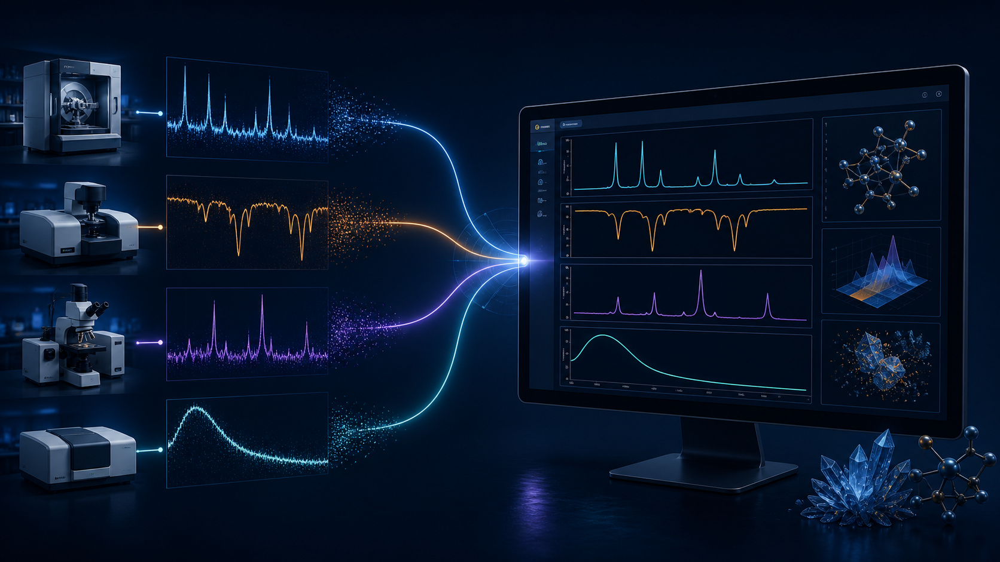

## 你以為今天要分析材料，結果第一個小時都在找「能開檔案的軟體」

材料實驗室最常見的浪費，不一定發生在公式或模型，而是發生在資料還沒進入分析之前。

XRD 儀器可能輸出 `.xrdml`、`.brml`、`.uxd`，也可能是 `.txt`、`.xy`、`.csv` 或 `.dat`；FTIR 常見 `.asc`；Raman 與 UV-Vis 又可能是另一種兩欄文字或 CSV 檔。當同一批樣品要跨不同儀器比較時，研究者往往必須先搜尋檔案格式、安裝轉檔工具、重新命名欄位，再把資料複製到 Origin、Excel 或自建的 Python 腳本。

這些步驟看起來只是前置作業，卻會直接影響後續的比較、峰偵測、圖表輸出與實驗紀錄。

## 檔案格式混亂，真正痛的是後面三件事

### 1. 轉檔讓資料多了一層不必要的風險

轉檔不一定會出錯，但每多一個中間檔，就多一個需要確認的地方：第一欄究竟是波數、波長還是 2θ？第二欄是 absorbance、transmittance 還是 intensity？數值單位有沒有被轉換？FTIR 的波數方向是否被反轉？

如果沒有把原始檔與轉換後的檔案清楚分開，幾週後回頭整理時，很難判斷哪一份才是最初的儀器輸出。

### 2. 同一批樣品被拆在不同軟體裡

XRD 在一個工具、FTIR 在另一個工具、UV-Vis 又用試算表處理，最後每個圖的字型、線寬、顏色和輸出尺寸都不一致。研究者不是只做一次分析，而是會在投稿、回覆審稿意見或補做對照實驗時反覆修改。

一旦樣品名稱或處理參數沒有同步，重新製圖就不只是按下 Export，而是重新找檔案、重新整理欄位、重新調整整張圖。

### 3. 未發表資料不適合任意上傳到線上服務

樣品配方、製程條件和原始光譜可能涉及尚未發表的研究。線上工具有時很方便，但實驗室會需要確認資料是否會離開電腦、是否必須建立帳戶，以及團隊能不能接受這種資料流程。

*圖 1｜不同儀器資料集中整理的概念流程；圖片為示意圖，非實際介面。*

## Spectra Studio 怎麼把「先處理檔案」變成「直接開始整理資料」？

Spectra Studio 的定位不是要求研究者重新學一套程式，而是把常見的光譜與繞射資料處理放進同一個 Windows 桌面工具。實際流程可以拆成幾個步驟。

### Step 1：先保留原始檔，再直接載入

建議把儀器原始資料放在唯讀或明確命名的資料夾，再將檔案載入 Spectra Studio。XRD 可處理常見的 `.xrdml`、`.brml`、`.uxd` 及 `.txt`、`.xy`、`.csv`、`.dat`；FTIR、Raman 與 UV-Vis 也能依常見的文字或 CSV 欄位格式載入。

直接載入的重點不是「所有資料都不需要檢查」，而是減少先轉成某一種中間格式的必要。載入後仍要確認軸名稱、單位、資料方向與訊號意義。

### Step 2：在 sample list 管理同一批樣品

多個檔案載入後，可在同一個工作區查看樣品清單，先決定要使用 overlay、stack 或 vertical offset。這樣做比把每條曲線複製到不同檔案再手動對齊，更容易保留樣品名稱與比較關係。

如果研究目的只是看峰位移，overlay 通常更直觀；如果曲線彼此遮住，stack 或 vertical offset 會比較容易閱讀。

### Step 3：先預覽 smoothing 與 baseline correction

資料格式統一後，才進入真正的圖譜整理。Savitzky–Golay smoothing 可用來降低高頻雜訊，ALS baseline correction 可用來處理背景漂移。建議先用預覽判斷參數是否改變了窄峰、寬峰或峰面積，不要把處理後的曲線直接當成無條件正確的資料。

### Step 4：從同一套樣式輸出圖表

當 XRD、FTIR、Raman 與 UV-Vis 都在同一個工作流程中，便能用相近的圖例、字體、線寬與座標軸規則製作報告或論文圖。Spectra Studio 提供 Nature、ACS 與 Elsevier 風格作為起點，再由研究者依目標期刊要求微調。

## Free 版與 Pro 版怎麼選？

如果目前的痛點是「檔案打不開、樣品太多、圖表很難整理」，Free 版可以先完成：

- 常見光譜與 XRD 檔案載入
- 多樣品 overlay、stack、normalize 與 vertical offset
- Savitzky–Golay smoothing
- ALS baseline correction
- 自動峰偵測
- Nature、ACS、Elsevier 樣式
- 無浮水印 PNG/JPG 輸出，最高 300 DPI

如果還需要 Gaussian、Lorentzian 或 mixed peak fitting、Scherrer、Williamson–Hall、Tauc bandgap，以及 PDF、SVG、EPS、TIFF 等輸出，再考慮 Pro 功能即可。兩個版本使用同一個安裝程式，不必為了升級重新建立一套資料流程。

## 載入資料後仍要檢查什麼？

工具能減少格式整理的時間，但不會替研究者做所有科學判斷。每次載入新儀器資料，至少確認：

1. 第一欄與第二欄的物理意義是否正確。
2. XRD 的橫軸是否為 2θ，FTIR 是否以 cm⁻¹ 表示，UV-Vis 是否為 wavelength。
3. FTIR 波數方向是否符合你的圖表習慣。
4. 吸光度、穿透率、反射率與強度是否被混用。
5. 處理前後的原始資料是否都有保存。

這些檢查不會因為使用專門軟體就消失；差別在於，你不必先把時間花在處理格式和切換工具上。

## 延伸閱讀

- [FTIR、Raman 光譜怎麼整理？批次疊圖、基線校正與投稿圖輸出](/zh/guides/ftir-raman-spectra-analysis/)
- [FTIR、Raman、XRD 多樣品疊圖怎麼不失控？從「一團線」到可讀的比較圖](/zh/guides/multi-sample-ftir-raman-xrd-comparison/)
- [Spectra Studio 光譜分析繪圖工具：把 XRD / FTIR / Raman / UV-Vis 數據變成可直接投稿的論文圖 — 不需要 Origin，也不需要 Python](/zh/guides/spectra-studio-guide/)

## 結語：把轉檔時間還給真正的材料問題

研究者需要的是比較晶相、峰位、官能基、吸收邊與樣品差異，而不是在不同檔案格式之間來回搬運欄位。Spectra Studio 將 XRD、FTIR、Raman、UV-Vis 與其他常見熱分析資料的載入、預處理、峰偵測、樣式和輸出集中在 Windows 本機工作流程中，適合想減少轉檔與重複整理的人。

👉 **免費開始整理你的儀器資料：**
[查看 Spectra Studio 功能與下載方式](https://hulab.pages.dev/zh/spectra-studio)
