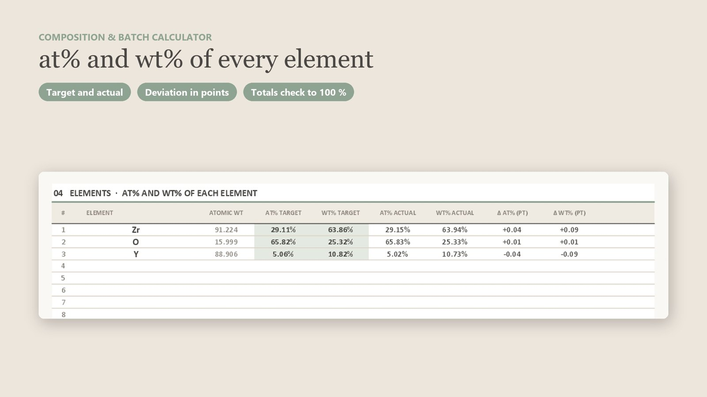
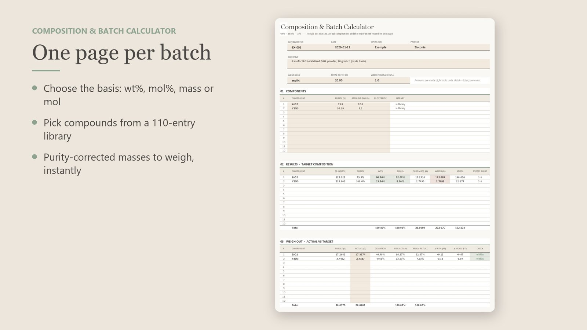

> **快速回答：** **mol% 換 wt%**：每個成分的莫耳分率乘上分子量後歸一化，wᵢ = xᵢMᵢ / Σ xⱼMⱼ。**wt% 換 mol%**：每個成分的重量分率除以分子量後歸一化，xᵢ = (wᵢ/Mᵢ) / Σ (wⱼ/Mⱼ)。**實際要秤的重量**＝純物質質量 ÷ 純度：需要 17.2510 g 的 ZrO₂、純度 99.9 %，就要秤 **17.2683 g**。下面所有範例都能用免費的 [batch_calc.py](/downloads/batch_calc.py) 腳本直接算出來。

配料看起來很簡單，直到審稿人問「8 mol% Y₂O₃ 是氧化物基準還是陽離子基準」，或是燒結後的樣品成分偏掉一點，才發現當初沒有修正瓶子上寫的 99.5 % 純度。這篇整理換算公式、最容易忘記的幾種修正，以及怎麼用實際秤到的重量檢查組成。

## 只需要三個公式

所有配料計算都回到莫耳數。成分 *i* 的分子量為 Mᵢ（g/mol）：

| 已知 | 要求 | 公式 |
|---|---|---|
| mol%（xᵢ） | wt%（wᵢ） | wᵢ = xᵢMᵢ / Σ xⱼMⱼ |
| wt%（wᵢ） | mol%（xᵢ） | xᵢ = (wᵢ/Mᵢ) / Σ (wⱼ/Mⱼ) |
| 純物質質量 mᵢ、純度 p | 實際秤重 | mᵢ / p |

批次大小通常指**純物質的總質量**（例如最後要得到 20 g 的氧化物粉末）。把每個成分的 wt% 乘上總質量得到純物質質量，再做純度修正。

分子量要用標準原子量計算，不要用課本上四捨五入的數字：Y₂O₃ = 2 × 88.906 + 3 × 15.999 = **225.809 g/mol**。四捨五入成 226，每個重量的第三位小數就跟著跑掉。

## 範例一：8 mol% Y₂O₃–ZrO₂（20 g，mol% 基準）

目標：92 mol% ZrO₂ + 8 mol% Y₂O₃，共 20 g 純粉末。純度：ZrO₂ 99.9 %、Y₂O₃ 99.99 %。

1. 分子量：ZrO₂ 123.222 g/mol、Y₂O₃ 225.809 g/mol。
2. 加權總和：0.92 × 123.222 + 0.08 × 225.809 = 131.429 g/mol。
3. wt%：ZrO₂ = 0.92 × 123.222 / 131.429 = **86.26 wt%**，Y₂O₃ = **13.74 wt%**。
4. 20 g 中的純物質：ZrO₂ **17.2510 g**、Y₂O₃ **2.7490 g**。
5. 實際秤重：17.2510 / 0.999 = **17.2683 g** ZrO₂；2.7490 / 0.9999 = **2.7492 g** Y₂O₃。

```bash
python batch_calc.py --basis mol --total 20 ZrO2:92:99.9 Y2O3:8:99.99
```

| 成分 | M（g/mol） | mol% | wt% | 純物質（g） | 純度 | **秤重（g）** |
|---|---|---|---|---|---|---|
| ZrO₂ | 123.222 | 92.00 | 86.26 | 17.2510 | 99.9 % | **17.2683** |
| Y₂O₃ | 225.809 | 8.00 | 13.74 | 2.7490 | 99.99 % | **2.7492** |

**注意基準。** 8 mol% Y₂O₃ **不等於**陽離子位置上有 8 % 的釔。每個 Y₂O₃ 帶兩個 Y，所以陽離子分率是 2 × 8 / (92 + 2 × 8) = **14.81 mol% YO₁.₅**。文獻兩種寫法都有（「8YSZ」是氧化物基準），論文的實驗方法裡請寫清楚你用哪一種。

## 範例二：用 BaCO₃ 和 TiO₂ 合成 BaTiO₃（前驅物基準）

很多時候秤的是會分解的前驅物。以固相反應做 10 g BaTiO₃，BaCO₃ + TiO₂ → BaTiO₃ + CO₂：

1. 產物莫耳數：10 / 233.194 = **0.042883 mol**。
2. BaCO₃：0.042883 × 197.338 = 8.4624 g 純物質，純度 99.8 % → 秤 **8.4794 g**。
3. TiO₂：0.042883 × 79.865 = 3.4248 g 純物質，純度 99.6 % → 秤 **3.4386 g**。
4. 檢查：前驅物合計 11.8872 g，其中 1.8872 g 以 CO₂ 離開（0.042883 × 44.009），剩下 10 g BaTiO₃。

常見錯誤是用氧化物基準（BaO + TiO₂）算好配方，再直接秤「BaO 的克數」的 BaCO₃，結果產物的鋇少了約 22 %。

## 範例三：硼矽酸鹽玻璃（wt% 換 mol%）

玻璃配方常以 wt% 表示。80 SiO₂ – 13 B₂O₃ – 4 Na₂O – 3 Al₂O₃（wt%），配 50 g：

```bash
python batch_calc.py --basis wt --total 50 SiO2:80 B2O3:13 Na2O:4 Al2O3:3
```

| 氧化物 | wt% | M（g/mol） | **mol%** | 純物質（g） |
|---|---|---|---|---|
| SiO₂ | 80.00 | 60.083 | **82.59** | 40.0000 |
| B₂O₃ | 13.00 | 69.617 | **11.58** | 6.5000 |
| Na₂O | 4.00 | 61.979 | **4.00** | 2.0000 |
| Al₂O₃ | 3.00 | 101.961 | **1.83** | 1.5000 |

Al₂O₃ 佔 3 wt%，換成莫耳只有 1.83 mol%，因為它比較重。如果你的結構討論是以莫耳為單位（網絡形成體、NBO/T），要先換算。實際配料時 Na₂O 和 B₂O₃ 通常用 Na₂CO₃ 與 H₃BO₃ 引入：先算出每個氧化物需要的莫耳數，再像範例二那樣換算成前驅物重量。

## 水合物：藏在化學式裡的誤差

硝酸鹽、氯化物前驅物常帶結晶水。若要用六水硝酸釔提供範例一的 2.7490 g Y₂O₃：

- 需要的 Y：2 × 2.7490 / 225.809 = 0.024348 mol。
- Y(NO₃)₃·6H₂O 的 M = 383.008 g/mol，所以要秤 **9.3255 g**。

如果誤用無水 Y(NO₃)₃ 的分子量（274.92 g/mol），只會秤 6.69 g，釔少了約 28 %。請核對瓶子上的化學式；易潮解的鹽類開封後還會吸水，成分要求嚴格時，請先乾燥或滴定金屬含量。

## 從化學式算出各元素的 at% 與 wt%

EDS、XPS、ICP 量到的是元素，不是化合物。要比對時，把每個化合物的莫耳數乘上原子個數、依元素加總，再以原子數（at%）或質量（wt%）歸一化。範例一的結果：

| 元素 | at% | wt% |
|---|---|---|
| Zr | 29.11 | 63.86 |
| O | 65.82 | 25.32 |
| Y | 5.06 | 10.82 |

EDS 很難準確量氧，所以比較陽離子比例：Y/(Y + Zr) = 5.06 / 34.17 = 14.8 %，和上面 YO₁.₅ 基準的 14.81 % 一致。



## 用實際秤到的重量檢查組成

沒有人能剛好秤到 17.2683 g。把實際秤到的重量記下來，用它重新算組成，這才是你真正做出來、也應該在論文報告的組成。實際秤了 17.3374 g ZrO₂ 和 2.7327 g Y₂O₃：

| | 目標（g） | 實際（g） | 偏差 | 實際 wt% | 實際 mol% |
|---|---|---|---|---|---|
| ZrO₂ | 17.2683 | 17.3374 | +0.40 % | 86.37 | 92.07 |
| Y₂O₃ | 2.7492 | 2.7327 | −0.60 % | 13.63 | 7.93 |

摻雜物秤差 0.6 %，只讓它偏了 0.07 mol%，對 8YSZ 沒有影響；但若摻雜量只有 0.5 mol%，同樣的秤重誤差造成的相對變化就大很多。每個成分訂一個容許偏差，超過就重秤。

## 常見錯誤檢查清單

- 批次大小定義成前驅物總重還是產物總重沒寫清楚。
- 忽略純度，或修正方向弄反（應該除以純度，不是乘）。
- 沒說明是氧化物基準還是陽離子基準（8 mol% Y₂O₃ = 14.81 mol% YO₁.₅）。
- 把碳酸鹽、硝酸鹽、氫氧化物當成氧化物來秤。
- 分子量漏了結晶水，或開封後吸了水。
- 沒修正燒失量、揮發（Na、K、Bi、Pb、B）與含水量。
- 分子量四捨五入，或自製試算表裡的打錯字一路被複製到每個批次。
- 論文報告的是名目組成，不是實際組成。

## 想用 Excel 直接算

[batch_calc.py](/downloads/batch_calc.py) 免費，可以完成上面所有換算。如果你想用試算表、順便留下實驗紀錄，**[Composition & Batch Calculator](https://jerryhome6.gumroad.com/l/composition-batch-calculator)**（$4.99）把每個批次做成一頁 Excel：

- 可用 wt%、mol%、克數或莫耳數輸入，最多 12 種成分，各自設定純度。
- 自動算出經純度修正的秤重量、mmol 與每個化學式的原子數。
- **秤重檢核：**輸入實際秤重，顯示偏差、實際 wt% 與 mol%，並依你設定的容許範圍標示是否合格。
- 各元素的 at% 與 wt%，目標與實際並排比較。
- 內建 110 種化合物（分子量由 118 個元素原子量計算）、實驗紀錄表，以及本文的三個範例。純公式、無巨集。



它和其他論文工具包都在[商店](/zh/shop/)。商品內容為英文。

## 常見問題

### wt% 要怎麼換算成 mol%？

把每個成分的重量分率除以分子量得到相對莫耳數，再除以莫耳數總和。例如 80 wt% SiO₂ 搭配 13 B₂O₃、4 Na₂O、3 Al₂O₃ 時，SiO₂ 是 82.59 mol%。

### 批次大小要用產物重量還是原料重量？

兩種都可以，只要一致；用產物（純氧化物）重量比較方便在批次之間比較。使用碳酸鹽或水合物時，原料會比產物重，因為加熱時 CO₂ 或水會離開。

### 秤重時怎麼修正純度？

把需要的純物質質量除以純度（以小數表示）。需要 17.2510 g 純 ZrO₂、純度 99.9 %，就秤 17.2510 / 0.999 = 17.2683 g。

### 8 mol% Y₂O₃ 和 8 mol% Y 有什麼不同？

8 mol% Y₂O₃ 是氧化物基準。每個 Y₂O₃ 含兩個釔原子，所以陽離子分率 Y/(Y + Zr) 是 14.81 %。論文中請註明使用哪一種基準。

### 可以從化學式算出各元素的 at% 嗎？

可以。把每個化合物的莫耳數乘上原子個數、依元素加總，再除以總原子數。8 mol% Y₂O₃–ZrO₂ 的結果是 Zr 29.11 at%、O 65.82 at%、Y 5.06 at%。
