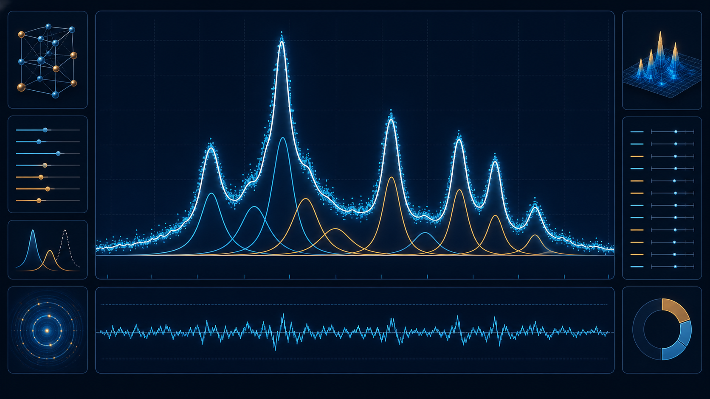

## 一個看起來很寬的峰，可能根本不是一個峰

XRD 分析最容易被低估的步驟，是從圖上取得可信的峰位置與峰寬。當峰形分離良好時，用游標讀取最高點似乎沒有問題；但只要有相鄰晶相、肩峰、背景漂移或訊雜比較低，眼前的「一個峰」可能其實是兩個甚至更多訊號疊在一起。

這時直接量整個包絡線的 FWHM，會把重疊造成的寬度也算進去。後面如果再把這個數值帶入 Scherrer 方程，得到的 crystallite size 就可能被系統性低估。

## 手動量峰寬，為什麼每次都可能不一樣？

### 峰頂不是永遠等於真正的峰中心

噪聲、步進間隔和相鄰峰會改變最高資料點的位置。不同人用游標點選，或同一個人隔幾天重新操作，可能得到不同的 2θ 與 FWHM。

### 基線會改變半高位置

背景如果向上傾斜，半高線的位置也會跟著變。沒有先處理基線，量到的寬度不只反映峰本身。

### 直接套用單一峰形會掩蓋模型問題

Gaussian、Lorentzian 和 mixed profile 對峰尾與寬度的描述不同。不是所有材料、儀器和展寬來源都適合同一種峰形；只看一個 R² 數字，也無法證明模型就一定合理。



*圖 1｜峰擬合應同時查看組成峰、總曲線與殘差；圖片為概念示意，非實際介面。*

## 從原始資料到可檢查峰擬合的五個步驟

### Step 1：保留原始資料，先處理背景與雜訊

先載入 `.xrdml`、`.brml`、`.uxd` 或常見兩欄文字資料，再預覽 Savitzky–Golay smoothing 與 ALS baseline correction。處理的目的，是協助辨識與擬合，不是讓曲線看起來比原始資料更完美。

過度平滑可能削弱窄峰，錯誤基線可能吃掉寬峰；因此每次調整都要回頭和原始曲線比較。

### Step 2：用自動峰偵測建立候選峰清單

Spectra Studio 的 auto peak detection 可依峰高與形狀找出候選位置，並允許調整 sensitivity。自動偵測適合取代「從頭用眼睛找每個峰」的工作，但結果仍要回到圖上確認：弱峰是否合理？背景起伏是否被誤判？肩峰是否值得拆分？

### Step 3：選擇合理的峰形與峰數

Pro 版提供 Gaussian、Lorentzian 與 mixed profile。可以先從符合研究領域與儀器條件的模型開始，再觀察峰頂、峰尾與重疊區的 residuals。峰數太少，可能把不同訊號合併；峰數太多，則可能變成沒有物理意義的 overfitting。

### Step 4：查看完整輸出，而不是只抄一個 FWHM

一次峰擬合至少要看：

- **Peak position**：峰中心位置。
- **FWHM**：半高寬。
- **Peak area**：峰面積。
- **R²**：模型對資料變異的描述程度之一。
- **Residuals**：原始資料與模型之間的差異。

如果 residuals 在峰頂、峰尾或某一側持續偏高，代表背景、峰形或峰數可能還需要檢查。R² 高，只能說明在該模型與區間下的數值貼合程度，不能單獨證明物理模型正確。

### Step 5：再把可信的峰寬帶入後續計算

以 Scherrer 方程估算微晶尺寸時，常見形式為：

```text
D = Kλ / (β cos θ)
```

其中 β 通常要使用弧度，θ 是 2θ 的一半；波長與 D 也要使用一致的長度單位。XRD 峰寬還可能受到儀器展寬、微應變、峰重疊與樣品缺陷影響，因此 Scherrer 結果應被描述為 crystallite size 或相干繞射域尺寸的估計，而不是直接等同於 SEM 粒徑。

當有多個品質良好的峰時，可以進一步使用 Williamson–Hall plot，討論尺寸與微應變的分離；但儀器校正與峰選擇仍然重要。

## Spectra Studio 解決的是「重複量測」，不是替你決定科學答案

Spectra Studio 將載入、平滑、基線、峰偵測、峰擬合與進階 XRD 分析放在同一個工作區，減少在多個軟體間複製數值的機會。Pro 版可從擬合結果延伸到 Scherrer 與 Williamson–Hall；Free 版則可先完成檔案載入、預處理、峰偵測與 PNG/JPG 圖片輸出。

但最終仍要由研究者決定：

- 哪些峰具有材料上的合理性？
- 哪個峰形符合你的研究方法與文獻？
- 是否需要儀器展寬校正？
- 重疊峰是否有足夠訊噪比支撐分離？
- 結果是否能被原始資料、殘差與實驗條件支持？

## 常見問題

### 重疊峰一定要拆成多個峰嗎？

不一定。是否分峰應由峰形、材料背景、對照資料與研究問題決定。為了讓 R² 變高而任意增加峰數，反而可能降低結果的可信度。

### FWHM 可以直接用度數放進 Scherrer 方程嗎？

通常不可以。β 應換算成弧度，並確認 θ 是 Bragg angle 而不是圖上的 2θ。

### 峰擬合後就能直接做晶粒尺寸比較嗎？

還不行。仍需確認峰形、背景、儀器展寬、波長、峰選擇與樣品條件。峰擬合只是讓峰寬取得方式更透明、可檢查。

## 延伸閱讀

- [XRD 峰擬合怎麼做？Gaussian、Lorentzian 與 FWHM 分析完整指南](/zh/guides/xrd-peak-fitting/)
- [XRD 晶粒尺寸怎麼算？Scherrer 方程與 Williamson–Hall 完整教學](/zh/guides/xrd-scherrer-williamson-hall/)
- [FTIR、Raman、XRD 多樣品疊圖怎麼不失控？從「一團線」到可讀的比較圖](/zh/guides/multi-sample-ftir-raman-xrd-comparison/)

## 結語：不要讓一個游標決定整段 XRD 結論

XRD 峰擬合的價值，不是把每條曲線硬拆得更漂亮，而是讓峰位置、FWHM、面積、模型和 residuals 都能被回頭檢查。Spectra Studio 將這段流程集中在 Windows 桌面工具中，幫助你減少手動抄數字與重複量測，把注意力放回晶相、尺寸與應變的科學判讀。

👉 **用自己的 XRD 資料試跑峰分析流程：**
[查看 Spectra Studio 功能與下載方式](https://hulab.pages.dev/zh/spectra-studio)
